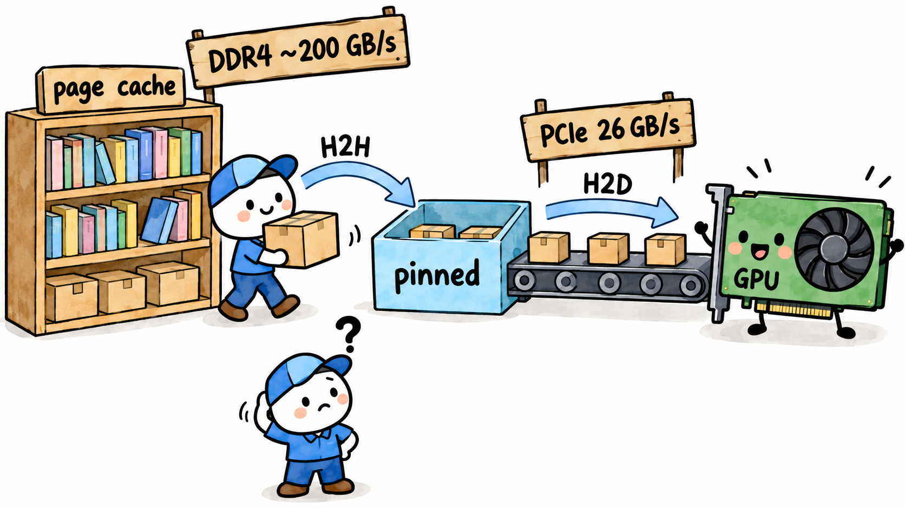
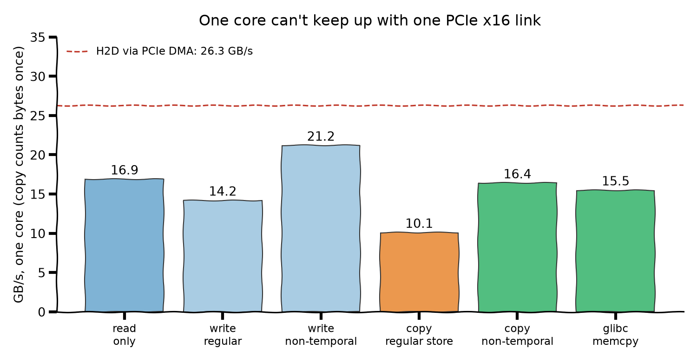
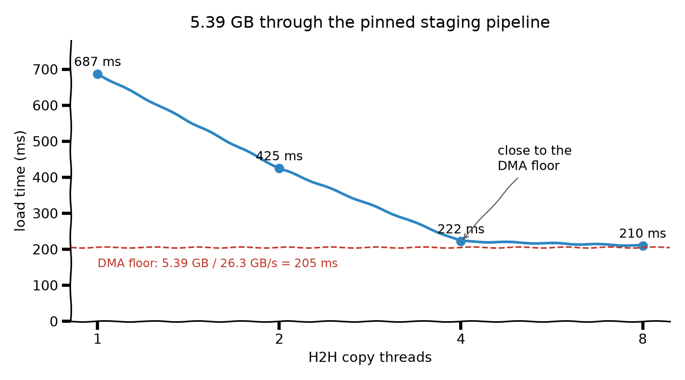

## 小记: PCIe比DDR慢, 瓶颈却在H2H拷贝

[上一篇](https://github.com/sujuyu/ZhangYu-s-Blog/tree/main/%E8%AE%A9AOTInductor%E6%A8%A1%E5%9E%8B%E5%BF%AB%E4%B8%8A%E5%BF%AB%E4%B8%8B%3A%20%E4%BB%8EPT2%E8%A7%A3%E5%8C%85%E5%88%B0%E5%A4%9A%E7%BA%BF%E7%A8%8BPinnedCopy)我们做AOTI模型加载加速的时候, 用了两块轮换的 pinned memory buffer: CPU 先把 page cache 里的 weight 拷到其中一块, 也就是 H2H; GPU 再通过 PCIe DMA 把它搬到显存, 也就是 H2D. 两块 buffer 交替使用, 让 CPU 拷下一块时, GPU 可以传上一块. 这里的 H2H 是 CPU 读源地址、写目标地址, 数据要经过缓存和内存控制器, 不是 DDR 颗粒在内部直接搬数据.

当时的结论是一个线程做 H2H 喂不饱 H2D, 换成 4 个线程就好了. 这个改动后来提给了 PyTorch, 就是 [pytorch/pytorch#195257](https://github.com/pytorch/pytorch/pull/195257).

在我的直观意识里面(面试八股文经验), DDR内存的带宽一般在"百GB/s"量级, PCIe带宽一般在"数十GB/s"量级, 潜意识里面我没怀疑过最终前者会成为拷贝的瓶颈.

这台机器是双路 AMD EPYC 7H12, 每颗 CPU 有八个 DDR4-3200 内存通道, 单颗 CPU 约 205 GB/s 的理论内存; 一张 A100 走 PCIe 4.0 x16, 实测 H2D 是 26.3 GB/s.

> 实测下来, 这条加载路径里的单线程 H2H 只有约 8 GB/s. 205 GB/s 和这个数之间, 差了带宽的统计口径、单核能发出的请求数, 还有首次访问映射时的缺页开销.

<div align="center">
  
</div>

### 205 GB/s 算的是什么

DDR4-3200 的 3200 指每秒 3200 百万次数据传输 (3200 MT/s), 已经算上了时钟上升沿和下降沿, 不需要再乘一次 2. 每通道的数据位宽是 64 bit, 也就是每次传 8 字节; ECC 校验位不计入有效数据带宽. 八通道的理论值就是:

```text
3200 × 10^6 次/秒 × 8 字节/次 × 8 通道
= 204.8 × 10^9 字节/秒
= 204.8 GB/s
```

这与 [AMD 对 7H12 标出的 Per Socket Mem BW](https://www.amd.com/en/support/downloads/drivers.html/processors/epyc/epyc-7002-series/amd-epyc-7h12.html) 一致. 这里的单路是指一颗 CPU, 不是一个内存通道. 两颗 CPU 的理论值可以合计成 409.6 GB/s, 但前提是两边的内存通道都被用起来; 单个线程访问一边的内存, 不能直接拿这个总数来算.

读和写共用每个 DDR4 通道的数据总线, 分时传输. 因此 204.8 GB/s 可以作为纯读或纯写时的数据总线理论上限; 读写混合时, 两者也要合用这份带宽, 不能同时各跑 204.8 GB/s.

拷贝还要多算一层: 从内存读出 1 GB, 再写回另一个位置, 至少产生 2 GB 的内存流量. 本文的 H2H 速度统一按 `拷贝的数据量 / 耗时` 算, 拷 1 GB 就记 1 GB, 不把读和写相加. 假设源和目标都在同一颗 CPU 的内存上、数据都要经过 DRAM, 即使没有其他开销, 按这个口径算出的拷贝速度也最多是 204.8 / 2 = 102.4 GB/s; 普通写还可能多一次目标数据的读取, 后面再说.

### 先测一把

用 torch 的 `copy_` 在一个线程里拷 2 GiB, 9.1 GB/s. 加线程: 2 个 14.0, 4 个 25.8, 8 个 38.8, 到 16 个停在 43 GB/s 左右. 一个线程只有 H2D 的三分之一, 4 个线程才追上.

所以问题变成: 一个核心为什么只能拷 9 GB/s?

### 一个核心能挂起多少内存请求

这里可以用利特尔法则 (Little's Law) 估算: 稳态下, 带宽 = 平均在途请求数 × 每个请求的字节数 ÷ 平均请求延迟. 内存通道有多宽是一回事, 一个核心能不能持续发出足够多的请求, 是另一回事.

这台机器的缓存行是 64 字节. 我让 Claude Opus 5.5 写了个链表追指针的小程序, 在 1 GiB 的区域里随机访问缓存行, 下一次访问的地址依赖上一次读取的结果, 测到平均每跳约 137 ns. 如果每次都要等上一行回来才能读下一行, 对应的缓存行传输速率只有 64 B ÷ 137 ns, 不到 0.5 GB/s. 这个 137 ns 是整条依赖访存路径的观测值, 也可能包含地址翻译开销, 不是单独测出的 DRAM 芯片延迟.

顺序拷贝不用这样串行等: 核心可以同时发出多个独立请求, 硬件预取器也会提前取后面的数据. 不过跟踪未完成请求的硬件资源是有限的. [AMD 的 Zen 2 优化手册](https://lsferreira.net/public/knowledge-base/x86/upos/amd_zen2.pdf#page=33) (56305 Rev. 3.02, §2.12) 写到, Load-Store 单元的 MAB (Miss Address Buffer) 最多跟踪 22 个在途 cache miss.

假设这 22 个请求都要去内存取一行, 每个都等 137 ns, 算出来是 22 × 64 B ÷ 137 ns ≈ 10.3 GB/s. 这个估算能说明有限并发为什么会限制单核带宽, 但不能据此认定 10.3 GB/s 就是单核拷贝上限: MAB 跟踪的 cache miss 不都要去 DRAM, 预取也会改变数据到达的时机, 顺序访问时的延迟更不能直接照搬随机追指针的结果.

### 预取器和写法

为了看看不同访问方式差多少, 我又让 Claude Opus 5.5 写了个小程序, 用 1 GiB 的 buffer 把单核的读、写、拷贝拆开测. 这组数据绑定 core 8, 内存放在 node0, buffer 在计时前已经写过一遍, 每项测三次取最快值.

核心是下面两种拷贝循环, 每次用 AVX2 指令搬 32 字节, 区别在于写入目标的指令. `src` 和 `dst` 是互不重叠、按 64 字节对齐的 buffer; `now()` 用 `CLOCK_MONOTONIC` 返回秒数, 这里省略分配、初始化和重复计时的代码:

```c
const size_t N = 1UL << 30;  // 1 GiB

// 普通写
double copy_regular(char* dst, const char* src) {
    double t = now();
    for (size_t i = 0; i < N; i += 32) {
        __m256i v = _mm256_load_si256((const __m256i*)(src + i));
        _mm256_store_si256((__m256i*)(dst + i), v);
    }
    return now() - t;
}

// 非临时写
double copy_nt(char* dst, const char* src) {
    double t = now();
    for (size_t i = 0; i < N; i += 32) {
        __m256i v = _mm256_load_si256((const __m256i*)(src + i));
        _mm256_stream_si256((__m256i*)(dst + i), v);
    }
    _mm_sfence();  // 放在结束计时之前, 将非临时写的 fence 开销计入
    return now() - t;
}
```

只读测试用同样的 load 循环, 将读出的向量做 XOR 累积, 最后写入 `volatile` 变量, 避免读取被编译器消掉; 纯写测试则把 load 换成预先准备好的常量向量. 另外单独测一组 `memcpy(dst, src, N)`. 每项的带宽都按 `N / 最短耗时 / 1e9` 换算成 GB/s, 拷贝也只计一次 N:

<div align="center">
  
</div>

只读有 16.9 GB/s, 已经超过前面的 10.3 GB/s 估算. 我倾向于认为硬件预取起了作用: 顺序访问比较容易预测, 数据可以在指令真正用到之前就取回来. 不过我没有做关闭预取的对照实验, 不能把这部分差额都归给 L2 预取器, 更不能拿 137 ns 倒推出硬件里确切有多少个在途请求.

使用普通 store 的拷贝只有 10.1 GB/s. 对于源和目标都不在缓存里的情况, 按通常的 write-allocate 路径算, 拷一条 64 B 缓存行需要读源、为目标做 RFO (read for ownership, 取得该行的写入所有权并取回数据), 最后再把修改过的目标行写回. 这样拷 64 B 就对应约 192 B 的内存流量. 10.1 GB/s 的有效拷贝速度, 对应的读流量约为 20.2 GB/s, 再加约 10.1 GB/s 的写回. 这是按访问方式估算的流量, 不是内存控制器计数器的实测值, 也不能据此断定碰到了 L2 的请求数上限.

换成非临时写 (non-temporal store), 连续写满整条缓存行时可以省掉目标行的 RFO 读, 流量降到每拷 64 B 约读 64 B、写 64 B. 实测拷贝到了 16.4 GB/s, 和只读差不多. 这也是前面说的, 同样叫"拷贝 1 GB", 不同写法占用的内存带宽并不一样.

这台机器用的是 Ubuntu glibc 2.31, 当时环境里的非临时写阈值是 3.375 MiB, 大块 `memcpy` 测到了 15.5 GB/s. [对应版本的实现](https://github.com/bminor/glibc/blob/glibc-2.31/sysdeps/x86_64/multiarch/memmove-vec-unaligned-erms.S) 会检查阈值和地址是否重叠, 不能把 3.375 MiB 当成所有 glibc 环境通用的切换点. 回头看 torch `copy_` 的 9.1 GB/s, 和普通 store 的 10.1 很接近, 我怀疑它走的是普通写, 不过还没检查实际执行的指令.

### 还有缺页

真实加载时, 权重在一个刚 mmap 出来的映射里. 文件已经在 page cache, 只代表数据在内存里; 进程对应的页表项仍可能没有建立. 首次访问时要进入内核补上映射, 这种不需要从磁盘读入文件数据的缺页叫 minor fault.

我还让 Claude Opus 5.5 照着 PR 的拷贝路径写了个复现程序. 在这个复现里, 平均每访问约 64 KiB 发生一次 minor fault, 每次约 3.7 µs, 单线程从 13.8 GB/s 掉到 7.9 GB/s. 这里的 64 KiB 是这次测试中观测到的平均间隔, 不是说系统页大小就是 64 KiB, 也不是每次缺页只会建立一页映射.

这里的 13.8 比上面的 15.5 低, 还涉及拷贝方向: 复现 PR 时目标地址高于源地址, 这版 glibc 走了反向拷贝; 把源和目标的地址相对顺序调过来, 测到的是 15.4 GB/s.

### 那就多开几个线程

单核受限, 就让几个核一起拷. 下面是 5.39 GB 的模型走 pinned staging 流水线的复现, 源数据是新映射, 带缺页:

<div align="center">
  
</div>

1 个线程 687 ms, 4 个线程 222 ms, 比按实测 H2D 算出的理想传输时间 205 ms (5.39 GB ÷ 26.3 GB/s) 只高 8%. 这个参照假设 H2D 始终能维持 26.3 GB/s, 没计入流水线启动、收尾和同步等开销. 8 个线程 210 ms, 在这个复现里已经很接近了, 再加线程也没多少可省的了.

在真实的模型上, 4 个线程把加载从 545 ms 降到了 333 ms, 比理想下限还多约 128 ms. 这部分花在哪, 还得分项去测, 留到下次.

### END

扯了一圈, 根源是205GB/s是八个内存通道合起来的理论带宽, 我却直接当成了一个线程的 memcpy 速度. 而H2D走DMA, DMA请求并发能力完全能撑起26.3GB/s的实测带宽.
