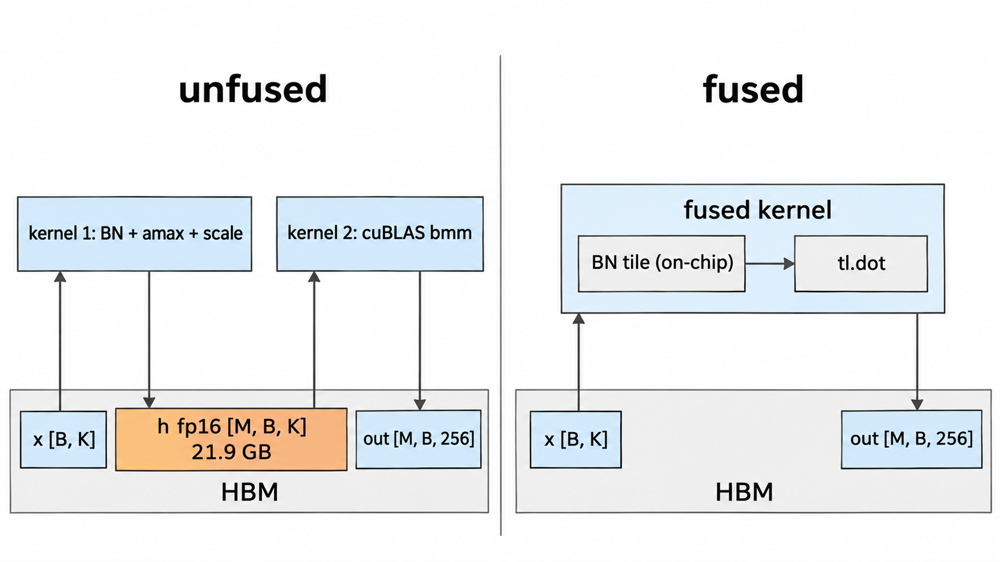
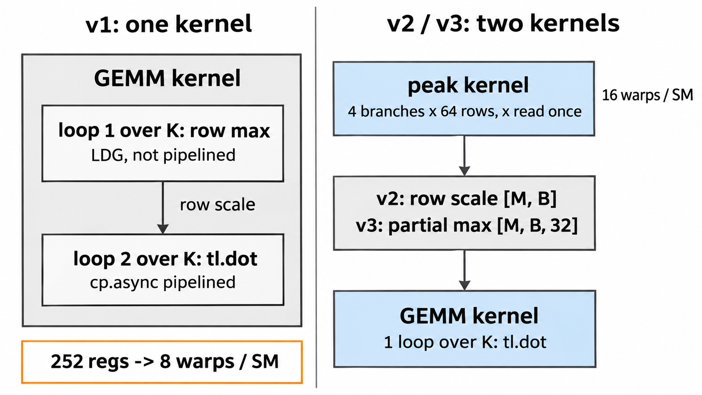
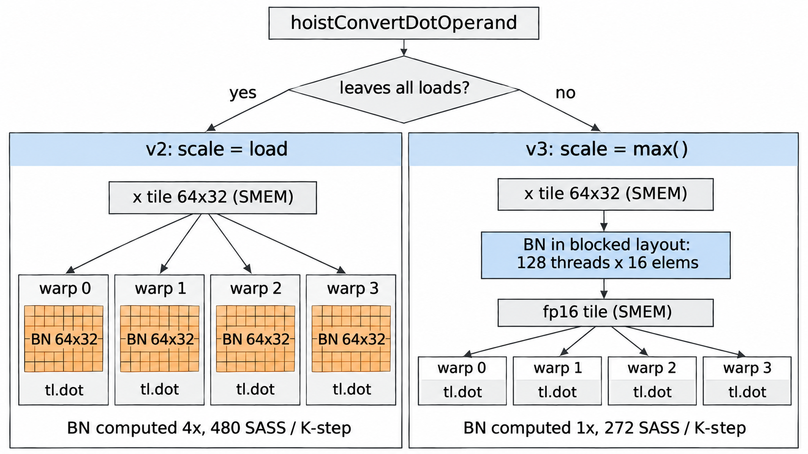

# Triton的优化是个黑盒 让我感到如此陌生

这个小blog是记录我最近遇到的一个问题, 我只需要提出问题, 代码层面全部是指挥Claude Opus5.5做的, 文章是我口述主旨, 让Claude结合实验留下的handoff记录文件写粗稿, 再由 GPT (gpt-6-astra) 粗核, 最后我改写搞出来的. 要不说还是当老板好, 能指挥别人干活可不得好吗😊

本身并没有什么难点, Triton在不同的写法下走了不同的优化路径, 低效的写法反而拿到了更高的性能, 我觉得很有趣, 所以专门记下来了.

我经手的这个模型里面有一个高频出现的结构: M 个结构相同的小 MLP 读同一份输入 x, 每个分支先过自己的 BN, 再过自己的第一层 linear. 批量化以后写成 PyTorch 大概是这样, 为了避免这个糟糕的模型在fp16下出现上溢, 这边多执行了一次sclae操作, 注释里是真实维度:

```python
# x: [B, K], B = 5025, K = 224 ~ 7936; 一共 29 组, M = 2 ~ 58, 合计 1000 个分支
h = x.unsqueeze(1).expand(B, M, K).reshape(B, M * K)       # 沿通道维复制 M 份 (不是在第 0 维 expand)
h = bn(h).view(B, M, K).transpose(0, 1)                    # BatchNorm1d(M*K), 每个分支一套统计量 -> [M, B, K]
peak = h.abs().amax(-1, keepdim=True).clamp_min(2 ** -100) # 每 (分支, 行) 的最大值, 全零的行取下限
s = 2 ** (15 - ceil(log2(peak)))                           # 2 的幂, 防 fp16 溢出, 后面细说
out = torch.bmm((h * s).half(), W, out_dtype=torch.float32) / s + b   # W: [M, K, 256] fp16
```


- bmm 是大维度映射到小维度 (K 最大 7936, O = 256), 它的输入 `[M, B, K]` 比输出大得多, 最多大 31 倍.
- 每个分支的 BN 统计量不同, 而且 BN 不能折进权重 (方差约等于 0 的通道, 折叠后是两个上万的数相减, FP32 下误差就到 1e-3). 这属于模型设计和训练的锅, 不过我是推理方, 受着吧

这篇记录给它手写 Triton 融合算子的过程, 前后改了三版. 当然实际上都是指挥claude写的, 我只需要提出问题和设想就好, 让claude直接总结:

- inductor 融不进来, 缩放后的 BN 输出要整块落显存 (这个专家库 29 组合计 21.9 GB), 所以自己写.
- 29 组从 62.6 ms 降到 44.7 ms, 快 1.40 倍, 输出逐位相同.
- 中间有一版把求最大值拆了出去, GEMM 的循环体一个字没动, 却慢了 29%. 原因是 Triton 的一条布局规则把 BN 挪进了 `tl.dot` 的操作数布局, 4 个 warp 各算一遍. 最后的解法是在 GEMM kernel 里故意多做一次归约, 挡住这次挪动. 这条规则不看代价, 光看 Triton kernel 源码看不出这个变化, 得翻编译后的 IR.

实验环境:

- GPU: NVIDIA A100 80GB PCIe
- Triton 3.7.1, PyTorch 2.16 + AOTInductor (自己编的 main 分支)
- 数据: 上面那个专家库的 29 组真实形状, 合成数据. 计时用 CUDA event, 每次计时前写 256 MB 清 L2. 各版本轮流计时取中位数: 同一个 kernel 连跑二十来次会降频 (6.6 ms 慢到 8.8 ms), 按版本成块计时会有 2~15% 的位置偏差

---


## 算scale和gemm都是规约操作 inductor本身不能融合两个连续规约

我原来的印象是 inductor 只做后融合 (epilogue), 不做前融合. 翻了一下源码 (`torch/_inductor/scheduler.py`), 前融合 (prologue fusion) 其实也有, 默认就是开的, 只是条件很严:

1. GEMM 得走 Triton 模板. 走 cuBLAS (ATen 后端) 时, GEMM 是一个 extern kernel, 前后什么都不融. 
2. 就算走 Triton 模板, 前融合也只收 "只喂这一个 GEMM 的 pointwise 节点" (源码里的拒绝理由是 `producer fusion only supported for pointwise nodes` 和 `template prologue can only fuse nodes with a single use`). 缩放系数是沿 K 的行最大值, 是一次归约; BN 的结果既要喂给这次归约, 又要喂给后面的乘法, 有两个使用者. 两条都过不去.

所以不管怎么配, bmm 的输入, 也就是缩放后的 fp16 `[M, B, K]`, 都得先写进显存, 再让 GEMM 读回来.

### BN结果显存写入量很大

- 29 组的 BN 输出合计约 109 亿个元素, FP32 是 43.7 GB, fp16 是 21.9 GB. 最大的一组 (M = 58, K = 7936) 单组 FP32 就 9.25 GB.
- 就算 inductor 把 BN, 求最大值和缩放融成最省的样子, 只物化一份 fp16, 写一遍再读一遍也是 43.8 GB 的流量. 按 A100 的 HBM 峰值 1.94 TB/s 算, 至少 22.6 ms. 这还没算 GEMM 本身: 5.6 TFLOP, 按 fp16 峰值 312 TFLOPS 算也要 17.9 ms. 这是按带宽算的下限, 没有实测.
- 显存也扛不住. 最早批量化第一层时, 就是把 x 复制成 `[B, M*K]` 再做 BN, 当时最大的一个模型这块张量 23 GiB, 因为模型数量比较多, 我会做多进程并发编译, 这个时候容易直接OOM.

<div align="center">
  
</div>

这里适合写一个 Triton kernel: GEMM 按块读 x 时在片上算 BN, 直接喂给 `tl.dot`, BN 的结果不出 SM.

### 为什么要缩放

BN 带来的 fp16 溢出, 上一篇 [模型优化工程实践: fix BN带来的数值溢出与cat造成的显存尖峰问题](https://github.com/sujuyu/ZhangYu-s-Blog/tree/main/%E6%A8%A1%E5%9E%8B%E4%BC%98%E5%8C%96%E5%B7%A5%E7%A8%8B%E5%AE%9E%E8%B7%B5%3A%20fix%20BN%E5%B8%A6%E6%9D%A5%E7%9A%84%E6%95%B0%E5%80%BC%E6%BA%A2%E5%87%BA%E4%B8%8Ecat%E9%80%A0%E6%88%90%E7%9A%84%E6%98%BE%E5%AD%98%E5%B0%96%E5%B3%B0%E9%97%AE%E9%A2%98) 已经吐槽过了, 本质上是模型设计和训练的锅. 训练时恒定的特征, running_var 约等于 0, BN 的 scale 能到几百. 推理时来一个分布外的样本, BN 输出就超过 fp16 的上限 65504. 办法也一样: 乘一个 2 的幂, 把最大值缩到 (2^14, 2^15] 再转 fp16, 累加完再除回去.

区别在于, 上一篇的 BN 输出是 GEMM 的右操作数, 按列缩放; 这里是左操作数, 收缩维 K 在列上, 所以按行缩放:

$$
(HW)_{i,:} = \sum_k H_{ik} W_{k,:}, \qquad s_i = 2^{\,15 - \lceil \log_2 \max_k |H_{ik}| \rceil}
$$

H 的第 i 行整体乘 s_i, 算出来的输出第 i 行也会乘上 s_i, 输出时再除回去就行. 整行全零时最大值取下限 2^-100, 不会出现 log2(0). 2 的幂只改指数位, 结果和 "假设 fp16 不溢出、直接转换" 逐位相同 (非规格化数的例外见上一篇).

麻烦在于, s_i 要等这一行 K 个 BN 输出全部算完才知道, 而 GEMM 是沿 K 一块一块累加的, 第一块乘之前就得用上 s_i. 所以行最大值必须先单独走一遍 K.

---

## v1: 一个 kernel, 两遍 K

最直接的写法: 每个 program 负责一个分支的 64 行 x 256 列输出, 先走一遍 K 求这 64 行的最大值, 再走一遍做 GEMM.

```python
pid_m, pid_b, pid_o = tl.program_id(2), tl.program_id(1), tl.program_id(0)   # 分支, 行块, 输出列块
# 第一遍: 这 64 行 BN 输出的 |max|
peak = tl.zeros([BLOCK_B], dtype=tl.float32)
for start_k in tl.range(0, k, TILE_K):
    normed = _normed(...)                                       # [64, 32], 片上算 BN
    peak = tl.maximum(peak, tl.max(tl.abs(normed), axis=1))
row_scale = _row_scale(peak)                                    # exp2(15 - ceil(log2(max(peak, 2^-100))))
# 第二遍: GEMM
acc = tl.zeros([BLOCK_B, BLOCK_OUT], dtype=tl.float32)          # [64, 256]
for start_k in tl.range(0, k, TILE_K):
    normed = _normed(...)
    weight = tl.load(...)                                       # [32, 256] fp16
    acc += tl.dot((normed * row_scale[:, None]).to(tl.float16), weight)
acc = acc / row_scale[:, None] + bias
```

当时的想法是: 求最大值只是逐元素运算加比较, 比 GEMM 便宜得多; x会多读一遍, 我的潜意识里面L2 cache成本很低, 而且正常都能放下, 所以直接让 Claude 这么干了

实测 29 组合计 62.6 ms. 把第一遍去掉、系数当作已知的单遍 GEMM 是 37.9 ms, 也就是说第一遍在这个 kernel 里花了约 24.7 ms, 占四成. 把同样的第一遍代码单独拎出来做成一个 kernel, 只要 13.0 ms. 同一段代码, 放进 GEMM kernel 就慢了将近一倍. 离线编译看寄存器和 SASS, 原因有两个:

- **寄存器被 GEMM 定死了.** 64 x 256 的 FP32 累加器, 每个线程就要 128 个寄存器, 整个 kernel 用到 252 个. 一个 CTA 128 个线程, 每个 SM 只放得下 2 个 CTA, 也就是 8 个 warp. 第一遍跑的时候也只有这 8 个 warp, 不够藏访存延迟. 单独成 kernel 时只用 56 个寄存器, 每个 SM 能放 36 个 warp.
- **第一遍默认没有软件流水.** kernel 启动参数里的 `num_stages=3` 默认只作用在含 `tl.dot` 的循环上, 第一遍循环里没有 dot, 没排上: SASS 里它用的是普通的 `LDG`, GEMM 循环里则是 `LDGSTS` (cp.async). 每个 K 块还要做一次跨线程的行归约 (12 条 `SHFL`).

流水其实能加: 第一遍本来就是 `tl.range`, 给它显式传 `num_stages=3`, 离线编译看 `LDG` 就变成了 `LDGSTS`. 但在 v1 的 kernel 里这样修修补补, 效果有限: 改成逐元素累计, 再加上 3 级流水, 最多快 9% (62.6 -> 57.4 ms). 加了流水, 每个 SM 也还是只有 8 个 warp.

当初还怀疑过 L2 兜不住 (大组的一份 x 有 160 MB, A100 的 L2 只有 40 MB). 第一遍单跑时, x 的逻辑读取是 43.7 GB / 13.0 ms = 3.37 TB/s, 超过了 HBM 峰值, 说明缓存复用是有的; 后来专门调过发射顺序, 让相邻的块在 L2 里复用 x, 也没有收益 (0.97~0.99x). 所以猜测 L2 不是主因.

---

## v2: 拆成两个 kernel

既然第一遍和 GEMM 挤在一起互相拖累, 就拆开: 一个专门求最大值的峰值 kernel, 算完把系数写进显存; GEMM kernel 读现成的系数, 只走一遍 K.

<div align="center">
  
</div>

峰值 kernel 不用再迁就 GEMM 的分块, 可以按自己的需要设计:

- 每块负责 4 个分支 x 64 行. 4 个分支读的是同一份 x, 只有 BN 参数不同, x 的一块读进来一次, 供 4 个分支用, x 的读取量降到约 1/4.
- 循环里只做逐元素的 max, 每 (分支, 行) 保留 32 道 (对应 K 块里的 32 列) 各自的最大值, 不做跨线程归约. 循环结束后才归约一次, 算出系数.
- 它用 127 个寄存器, 每个 SM 16 个 warp, 比把旧第一遍单独拎出来跑时的 36 个 warp 还少, 时间却从 13.0 ms 降到 6.6 ms. 拆开只是让第一遍不再被 GEMM 的 8 个 warp 拖累, 再往下快, 靠的是上面两条.

```python
pid_b, pid_m = tl.program_id(0), tl.program_id(1)             # 行块在前: 相邻的块用同几个分支的 BN 参数
peak = tl.zeros([BLOCK_M, BLOCK_B, TILE_K], dtype=tl.float32)  # [4, 64, 32]
for start_k in tl.range(0, k, TILE_K):
    x = tl.load(...)                                           # [64, 32], 4 个分支共用
    mean, scale, beta = ...                                    # [4, 32]
    normed = (x[None, :, :] - mean[:, None, :]) * scale[:, None, :] + beta[:, None, :]
    peak = tl.maximum(peak, tl.abs(normed))                    # 逐元素累计, 不归约
row_scale = _row_scale(tl.max(peak, axis=2))                   # v2: 循环外归约一次, 存 [M, B] 的系数
```

GEMM kernel 只改了一处: 行系数不再由 kernel 自己算, 改成从显存读.

```python
row_scale = tl.load(row_scale_ptr + pid_m * batch + offset_b, mask=offset_b < batch)  # v2: 读现成系数
acc = tl.zeros([BLOCK_B, BLOCK_OUT], dtype=tl.float32)
for start_k in tl.range(0, k, TILE_K):                         # 循环体和 v1 的第二遍一字不差
    ...
```

峰值部分从 24.7 降到 6.6 ms, 总时间却只从 62.6 降到 55.8 ms.  GEMM **离奇**地从 37.9 涨到了 48.7 ms, 慢了 29%. 

---

## 让agent直接分析编译产物

这里用的 `triton.language` 不直接指定布局 (layout): 每个张量的元素怎么分到线程和寄存器里, 由编译器决定. 想知道它做了什么, 只能看它的中间产物. 好在这些都不需要 GPU: `triton.compile` 可以指定 `GPUTarget("cuda", 80, 32)` 直接对 A100 编译, 导出 TTGIR (带布局的 MLIR), PTX 和 cubin, 再用 Triton 自带的 nvdisasm 出 SASS.

### SASS: 同样的循环, 多了 208 条指令

统计 GEMM 主循环里每个 warp 处理一个 32 宽的 K 块要执行的 SASS:

| | 循环体 | HMMA | FFMA / FADD / FMUL | F2FP (转 fp16) | LDS | STS | LDSM |
|---|---:|---:|---:|---:|---:|---:|---:|
| v1 第二遍 (系数在 kernel 内算) | 272 | 64 | 16 / 16 / 16 | 8 | 13 | 4 | 16 |
| v2 (系数从显存读) | 480 | 64 | 64 / 64 / 64 | 32 | 47 | 0 | 8 |

Tensor Core 指令一样多; BN 的 FP32 运算和 fp16 转换正好变成了 4 倍; 往共享内存写的 `STS` 没了, 从共享内存读的 `LDS` 从 13 条涨到 47 条.

### TTGIR: BN 换了个布局去算

v1 第二遍的循环, 精简后:

```mlir
%x  = ttg.local_load %x_smem      : -> tensor<64x32xf32, #blocked1>
%bn = arith.subf / mulf / addf ... : tensor<64x32xf32, #blocked1>          // BN 在 blocked 布局里算
%h  = arith.truncf ...             : tensor<64x32xf16, #blocked1>
%a  = ttg.local_alloc %h           : -> !ttg.memdesc<64x32xf16, #shared3>   // 写进共享内存
%a2 = ttg.local_load %a            : -> tensor<64x32xf16, #ttg.dot_op<{opIdx = 0, parent = #mma}>>
%acc = tt.dot %a2, %w, %acc
```

v2 的循环:

```mlir
%x  = ttg.local_load %x_smem      : -> tensor<64x32xf32, #ttg.dot_op<{opIdx = 0, parent = #mma}>>
%bn = arith.subf / mulf / addf ... : tensor<64x32xf32, #ttg.dot_op<...>>   // BN 直接在 dot 操作数布局里算
%h  = arith.truncf ...             : tensor<64x32xf16, #ttg.dot_op<...>>
%acc = tt.dot %h, %w, %acc
```

两种布局的区别在于:

- `#blocked1` 是 `sizePerThread = [1, 4], threadsPerWarp = [4, 8], warpsPerCTA = [4, 1]`: 128 个线程把 64 x 32 的 tile 分摊掉, 每个元素只归一个线程, 每个线程 16 个元素.
- `#mma` 是 `warpsPerCTA = [1, 4]`: 4 个 warp 沿输出列排开, 各算 64 列输出. 每个 warp 都要用整块 64 x 32 的左操作数, 所以在 dot 操作数布局里, 这块 tile 在 4 个 warp 之间是复制的.

于是:

- v1: BN 只算一次 (每个线程 16 个元素), 转成 fp16 写进共享内存, 4 个 warp 再各自按 dot 操作数布局读出来 (`LDSM`).
- v2: 每个 warp 从共享内存读整块 FP32 的 x, 自己把整块 BN 算一遍. 省掉了一次共享内存的写和一次 barrier, 代价是 BN 算了 4 遍.

在这个 kernel 里, BN 加缩放是每个元素 3 条 FP32 指令 (FADD, FFMA, FMUL) 再加一次转换, 4 倍下来比一次共享内存往返更耗时.

### 是哪个 pass 干的

把每个 pass 前后的 IR 都打出来 (`MLIR_ENABLE_DUMP=1`) 对比, 变化出在 `TritonGPURemoveLayoutConversions` 这个 pass 的 `hoistConvertDotOperand` 函数里 (Triton v3.7.1, `lib/Dialect/TritonGPU/Transforms/RemoveLayoutConversions.cpp`).

这个pass做的事是把 "换布局" 这一步往前挪. `tl.dot` 要求左操作数按 dot 的布局摆好, 正常的顺序是先把数算完, 最后换一次布局; 这个函数会把换布局挪到最前面, 刚 load 完就换, 后面的计算直接在 dot 的布局里做 (v3 下一节讲, 它的 GEMM 循环和 v1 的第二遍一样):

```
v1 / v3 (没挪): load x -> 算 BN, 乘系数, 转 fp16 -> 换布局 (经共享内存发给 4 个 warp) -> dot
v2      (挪了): load x -> 换布局 (4 个 warp 各读一整块 x) -> 算 BN, 乘系数, 转 fp16 -> dot
```

源码注释说这么做是为了让这些 load 方便做流水, 效果上也省掉了一次共享内存中转, 适合 "load 低精度权重 -> 反量化 -> dot" 这类 kernel. 但在我们这里, dot 的布局要求每个 warp 都拿整块左操作数, 换布局挪到前面以后, 4 个 warp 就各算一遍 BN. 省了一次中转, 多算了 3 遍 BN.

pass生效的条件:

1. 从 dot 往上倒着看, 中间只能是逐元素的运算 (加减乘除, 类型转换这种, 每个结果只看同一位置的输入, 换到哪种布局都能各算各的);
2. 倒到最上面, 必须全是 load 或常量.

碰到归约这种要把别的线程手里的数据凑到一起的运算, 或者最上面不是 load, 就不挪. 对照几个版本:

- v1: 行系数来自第一遍循环里的 `tl.max`, 是归约, 不挪.
- v2: 行系数是 load 进来的, BN 用的 x, mean, scale, beta 也都是 load, 两条都满足, 挪了.
- 我还试了一个 v2': 峰值 kernel 只存每行的最大值, GEMM 里再算 `exp2(15 - ceil(log2(peak)))`. exp2, log2 也是逐元素运算, 照样挪 (循环体 477 条).

想翻源码的话, 两条规则对应函数里这两句注释:

```cpp
// We hoist over any operation that can be done without data movement between threads
// We expect the leaves of the slice to be Load, DescriptorLoad or arith::Constant
```

<div align="center">
  
</div>

---

## v3: 妥协的低效写法 留一次归约

那就在行系数的计算里留一次归约, 挡住这次上提. 峰值 kernel 结尾不再归约, 把每 (分支, 行) 的 32 道部分最大值原样存成 `[M, B, 32]`; GEMM kernel 开头读进来, 自己做最后一步 `tl.max`:

```python
if SCALED:
    lanes = tl.arange(0, TILE_K)
    peak = tl.load(peak_ptr + (pid_m * batch + offset_b[:, None]) * TILE_K + lanes[None, :],
                   mask=offset_b[:, None] < batch, other=0.0)        # [64, 32] 的部分最大值
    row_scale = _row_scale(tl.max(peak, axis=1))                     # 就是这次归约挡住了上提
```

代价是 GEMM 多读 `[M, B, 32]` 的部分最大值 (29 组共约 0.64 GB), 再做一次 64 x 32 的归约, 都在循环外面. 循环体回到 272 条, GEMM 约 38.1 ms, 和 v1 第二遍的 37.9 ms 基本持平.

| 版本 | 峰值部分 (ms) | GEMM (ms) | 合计 (ms) | 对 v1 |
|---|---:|---:|---:|---:|
| v1: 一个 kernel 走两遍 K | ≈ 24.7 | 37.9 | 62.6 | 1.00x |
| v2: 峰值 kernel 存系数 | 6.6 | 48.7 | 55.8 | 1.12x |
| v3: 峰值 kernel 存 32 道部分最大值 | 6.6 | ≈ 38.1 | 44.7 | 1.40x |

- 三行来自同一次运行的轮流计时. 合计是整个算子端到端的时间, 分项是单独计时, 两者不一定严格相加 (v2 的分项之和是 55.3 ms). v1 的峰值部分 = v1 合计 - 单遍 GEMM, v3 的 GEMM = v3 合计 - 峰值 kernel, 这两个是减出来的.
- 最终提交的版本在另一次运行里是 63.5 -> 45.9 ms (1.38x). 两次运行的 v1 差 1.4%, 是卡温漂移. 所有版本的输出与 v1 逐位相同.

更干净的方案肯定是看一下有没有公开的某个api, 能让我们关掉某个Pass.

---

## 指挥别人干活还是爽😊

- 用 `triton.compile` 指定 `GPUTarget`, 用 `MLIR_ENABLE_DUMP=1` 看每个 pass, 再用 nvdisasm 数 SASS. 感谢Claude, 没有agent我哪里会去看这玩意

---

## 附记: 同一批实验里还踩了个坑

给第一层加 fp16 输出时, 一个输出块盖住整行, 在 epilogue 里求行最大值, 直接给下一层算好 fp16 输入和系数. 第一版把系数按一维 `[BLOCK_B]` 存, Triton 为了这个一维 store, 把整块 64 x 256 的 FP32 累加器换到另一种布局, 再归约一遍: SASS 5328 条, 80 字节 spill, 29 组 50.8 ms. 改成 `tl.max(acc, axis=1, keep_dims=True)` 按 `[BLOCK_B, 1]` 存以后, 只归约一次, 没有 spill, 2528 条.

