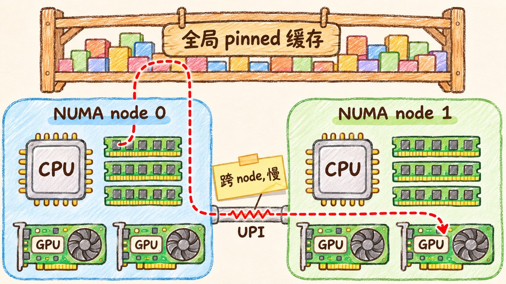
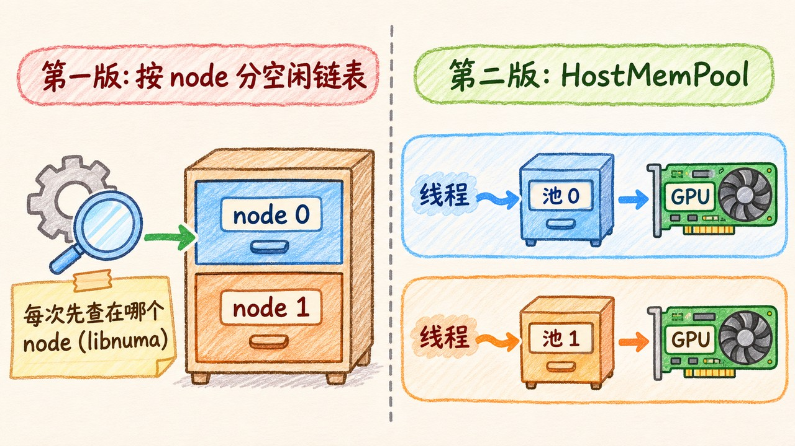
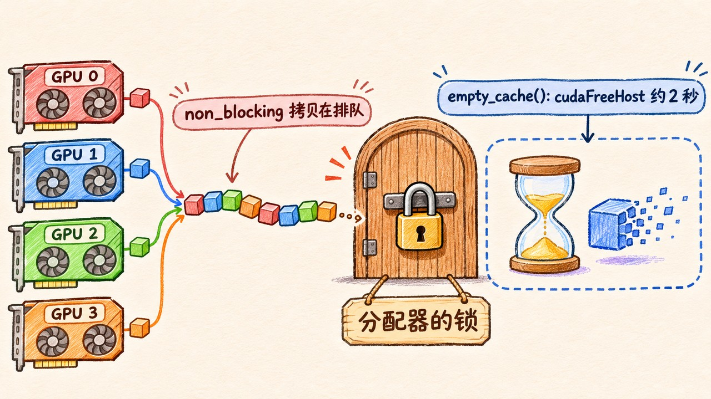
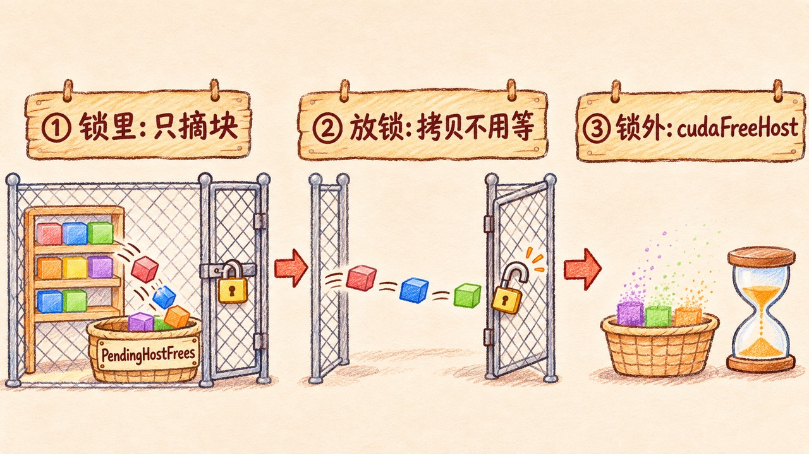

## 为 PyTorch CachingHostAllocator 补齐用户可控 Memory Pool 能力

本篇提到的内容已经整合成了多个PR, 并且已经合入上游 PyTorch 主干.

核心PR:
- [#200733](https://github.com/pytorch/pytorch/pull/200733): `free_block` 挪到分配器锁外
- [#200762](https://github.com/pytorch/pytorch/pull/200762): `torch.cuda.HostMemPool`

附加的PR和issue:
- [#197868](https://github.com/pytorch/pytorch/pull/197868): 第一版, 按 NUMA node 拆缓存 (已关闭), 讨论都在这里
- [#199144](https://github.com/pytorch/pytorch/pull/199144), [#199145](https://github.com/pytorch/pytorch/pull/199145): 实现过程发现的两个既有小bug
- [#160420](https://github.com/pytorch/pytorch/issues/160420): `CachingHostAllocator` 复用空闲块时不考虑 NUMA 亲和的 issue


叠甲声明: 整体思路是经由 PyTorch 相关 maintainer 讨论迭代而来, 代码部分是指挥Claude Opus5.5实现的, GPT6-Astra参与设计和代码的复核, 我review了除UT之外的代码. 这篇小博客是我口述, 让Claude Opus5.5整理出粗稿, 再由我改写得到的, 可能还是免不了有AI味.

在使用 PyTorch 的时候, 对于显存上的分配操作, 创建一个独立的memory pool是一种司空见惯的操作, 类似于下面这样:
```python
import torch
pool = torch.cuda.MemPool()
# 在该池的上下文中分配张量
with torch.cuda.use_mem_pool(pool):
    a = torch.randn(1000, 1000, device='cuda')
```

BTW在我们的PR合入之前, PyTorch 的 Host Pinned Memory 缓存是全局一份的, 本身并没有`split-pool`的概念. 也就是说并没有一个对应于`torch.cuda.HostMemPool`的概念. 同时, 这个全局一份的缓存池, 本身也不感知 NUMA node, 于是在频繁的分配和归还操作中, 多 node 机器上可能会把 node A 的一块pinned memory buffer分配给 node B 上运行的线程, 进而造成数据跨UPI传输的问题, 生产中表现为随机但是高概率出现的H2H或者H2D异常时延.

起初, 我有一个朴素粗暴的解决思路, 即直接在`CachingHostAllocator`上按照NUMA node进行分池, 但是核心maintainer (ngimel等) 建议换成更通用的做法, 也就是引入CUDA device上的`MemPool`类似的分池能力, 这样用户可以自建 host 内存池, 由于`cudaHostAlloc`本身能根据当前线程所在的NUMA node进行分配, 所以自然而然这个pool分配出来的buffer跟当前线程亲和, 同时还避免引入了libnuma的依赖, 相当于是扩展了我们朴素思路的边界, 实现起来更加干净清爽.

在实现过程中, 由于`HostMemPool`不再是全局唯一, 有了生命周期, 因此需要在销毁时归还内存, 我们发现`empty_cache()` 一直在持锁调用很慢的 `cudaFreeHost`, 导致其他线程上的`CachingHostAllocator`调用全部阻塞, 于是我们考虑把析构分成"标注为待释放"和"调用`cudaFreeHost`"两个step.


### 现状是一份全局的pinned缓存

前面几篇写过我们怎么给 AOTInductor 模型做快速上下线: 模型文件先从 page cache 拷到 pinned memory (H2H), 再从 pinned memory 拷到显存 (H2D), 中间用几块轮换的 pinned buffer, 多个线程一起搬 ([让AOTInductor模型快上快下](https://github.com/sujuyu/ZhangYu-s-Blog/tree/main/%E8%AE%A9AOTInductor%E6%A8%A1%E5%9E%8B%E5%BF%AB%E4%B8%8A%E5%BF%AB%E4%B8%8B%3A%20%E4%BB%8EPT2%E8%A7%A3%E5%8C%85%E5%88%B0%E5%A4%9A%E7%BA%BF%E7%A8%8BPinnedCopy), [PCIe比DDR慢, 瓶颈却在H2H拷贝](https://github.com/sujuyu/ZhangYu-s-Blog/tree/main/PCIe%E6%AF%94DDR%E6%85%A2%2C%20%E7%93%B6%E9%A2%88%E5%8D%B4%E5%9C%A8H2H%E6%8B%B7%E8%B4%9D), [警惕NUMA自动均衡](https://github.com/sujuyu/ZhangYu-s-Blog/tree/main/%E8%AD%A6%E6%83%95NUMA%E8%87%AA%E5%8A%A8%E5%9D%87%E8%A1%A1%3A%20%E7%BB%91%E5%A5%BD%E4%BA%86node%2C%20%E6%90%AC%E8%BF%90%E5%8D%B4%E8%BF%98%E6%98%AF%E6%85%A2)). 多线程搬运那部分后来提给了 PyTorch, 就是 [#195257](https://github.com/pytorch/pytorch/pull/195257).

这些 pinned buffer 不是我们自己 `cudaHostAlloc` 出来的. AOTInductor 的加载代码通过 `aoti_torch_empty_strided_pinned` 申请, 最终走的是 ATen 的 `CachingHostAllocator`: 释放的块先留在缓存里, 下次按大小直接复用, 不用每次都付 `cudaHostAlloc`/`cudaFreeHost` 的代价.

问题在于这份缓存全进程只有一份 (CUDA graph 录制时用的私有池除外), 复用时只看大小, 不看块在哪个 node 上.

我的开发机器是双路的, 6 张 A100, 4 张挂在 node0, 2 张挂在 node1. 我们给每张卡配了一个加载线程, 绑在卡所在的 node 上. 可 node1 的线程从缓存里拿到的, 很可能是 node0 的线程刚还回来的块, 它的物理页在 node0. 这样 page cache 到 pinned memory 的 H2H 要跨一次 node, 后面 pinned memory 到显存的 DMA 再跨一次.

<div align="center">
  
</div>

<div align="center">一份全局缓存, node1 的显卡用上了 node0 的内存块</div>

跨 node 走UPI总线会拖慢整体的拷贝速度, 这台机器上同 node 的 H2H 能跑到 116 GiB/s 左右, 跨 node 只有 36 GiB/s 左右. 而且快慢跟着缓存里拿到什么块走, 时好时坏.

### 朴素实现: 在`CachingHostAllocator`中对node进行分池

最直接的想法是让缓存按 node 分开: 每个 node 一组空闲链表, 线程分配时先查自己在哪个 node, 只从这个 node 的链表里拿. 我们按这个思路提了 [#197868](https://github.com/pytorch/pytorch/pull/197868).

这个思路原理上没什么问题, 在申请buffer的时候调用libnuma: `numa_node_of_cpu(sched_getcpu())`获取当前Thread所在的node信息即可, 但是这个调用操作一次大概 562 ns, 放在分配热路径上并不低, 其次是这样还需要引入对libnuma的依赖, 我自己觉得对于PyTorch这样使用预构建包进行发版的项目侵入很大, 毕竟不是什么发行版Linux上都有libnuma.


maintainer (ngimel, kapilsh 等) 给了一个方向: 与其把"按 NUMA node 分"这条规则写在 host allocator 里, 不如做一个更通用的东西, 像 device 上 `CUDACachingAllocator` 的 `beginAllocateToPool` 那样, 让调用方自己决定哪些线程用哪个池. 分配器里已经有给 CUDA graph 用的私有 pinned 池, 算是做了一半.

这个方向确实更干净: NUMA 策略留在分配器外面, 分配器也不用依赖 libnuma. 于是第一版没有再往下推, 关掉了.

### 第二版: 把缓存拆成池

第二版加了 `torch.cuda.HostMemPool`. 它是一个独立的 pinned 内存池, 和 device 上的 `torch.cuda.MemPool` 一样用 `use_mem_pool` 进入:

```python
import os
import torch

# cpus_of_node[k]: node k 上的 CPU 列表
pools = [torch.cuda.HostMemPool() for _ in cpus_of_node]

def loader(node):
    os.sched_setaffinity(0, cpus_of_node[node])  # 先绑核, 再进池
    with torch.cuda.use_mem_pool(pools[node]):
        buf = torch.empty(n, pin_memory=True)    # 从 pools[node] 里拿
        ...
```

实现上遵守几条规则:

- 只有进入了池的那个线程会路由到这个池, 它新起的线程不会. 多个线程可以同时进同一个池.
- 池之间的缓存是隔开的. 一个块不管被哪个线程释放, 都回到它出生的那个池, 之后只发给进了这个池的线程.
- `torch.empty(..., pin_memory=True)`、`tensor.pin_memory()` 都走这条路由. AOTInductor 加载时申请的 staging buffer 也一样, 只要加载是在进了池的线程里做的.

池本身并不感知 NUMA, 但是 `cudaHostAlloc` 在调用的时候会实际分配物理page, 按 Linux 默认的内存策略, 页落在调用线程当时所在的 node 上. 所以只要 node k 上的线程只进 `pools[k]`, `pools[k]` 里的块就都在 node k 上. 实测一个绑在 node k 上的线程在 `pools[k]` 里分配的 64 MiB 块, 页全部在 node k 上. 整个过程不依赖 libnuma, 就实现了 NUMA 亲和.

<div align="center">
  
</div>

<div align="center">左: 一个缓存按 node 分层, 每次分配先查自己在哪; 右: 每个 node 一个池, 线程各进各的</div>

分池还顺带解决了另一件事. 原来所有线程挤在同一份缓存的锁上, 8 个线程同时分配释放小 pinned tensor 时, 每次要 8.9 µs; 各用各的池以后降到 0.4 µs, 和单线程差不多:

| 每次 allocate+free 的中位数 (ns) | 改之前, 不用池 | 改之后, 不用池 | 改之后, 各用各的池 |
|---|---:|---:|---:|
| 1 个线程 | 407 | 401 | 412 |
| 8 个线程 | 8927 | 8620 | 422 |

### 池会被销毁, 销毁时要还内存

全局缓存是不会销毁的, 正常也不做Free操作, 除非有人主动调 `empty_cache()`. 池不一样, 用户删掉它, 自然这部分内存应该还给操作系统.

device 上的 `MemPool` 析构时会顺手对这个池做一次 `emptyCache`, 把空闲块立刻还回去. Host池的最初实现也参照了这个做法, 即析构时对`CachingHostAllocator`**上锁**, 然后对待释放块调用`cudaFreeHost`. 问题是`cudaFreeHost`本身开销比较大:

- 它会等当前 GPU 上已经排队的工作全部做完. 卡上排着一个 2.1 s 的 kernel 时, 它等了 2151 ms; kernel 在另一张卡上时只要 9 ms.
- 它本身也慢. GPU 空闲时, 每 64 MiB 要 11.7 ms, 因为要逐页解锁; 同样大小的 `cudaFree` 只要 0.3 ms.
- 它在等的时候, 同一张卡上其他线程的异步拷贝也会被挡住, 这是驱动层面的行为, 我们改不了. 另一张卡上的拷贝基本不受影响, 最长 0.7 ms.

<div align="center">
  
</div>

<div align="center">一个慢释放占着锁, 所有卡的拷贝都排在锁外</div>

`cudaFreeHost`期间一直持有`CachingHostAllocator`的锁, 导致一切依赖`CachingHostAllocator`的线程, 在那个瞬间都在阻塞, 相当于直接放大了`cudaFreeHost`的影响.

### 两步法: 锁里摘, 锁外放

锁保护的其实只是分配器内部的几张表: 空闲链表、块集合、指针到块的映射. 一个块只要从这些表里摘掉, 别的线程就再也找不到它, 释放它就不需要锁. 所以拆成两步:

```cpp
// 之前: 持锁调用 cudaFreeHost
{
  std::lock_guard<std::mutex> g(pool.blocks_mutex_);
  ...
  free_block(block);   // cudaFreeHost, 可能卡几秒
}

// 之后 (示意): 锁里只摘, 锁外再放
PendingHostFrees frees{*this};
{
  std::lock_guard<std::mutex> g(pool.blocks_mutex_);
  detach_block(block, frees);  // 从各张表里摘掉, 交给 frees
}
frees.free();                  // 锁已经放开, 再 cudaFreeHost
```

<div align="center">
  
</div>

<div align="center">锁里只做摘块, 慢的释放挪到锁外</div>

改完以后, 同样的测试里, 另一张卡上最长的一次拷贝从 2140 ms 降到 1 ms 左右. `empty_cache()` 本身还是要 2140 ms, 同一张卡上的拷贝也还是要等, 这跟`cudaFreeHost`会获取驱动锁相关, 并非我们的代码引入.

### 结果

释放这一层先合入, 就是 [#200733](https://github.com/pytorch/pytorch/pull/200733); `HostMemPool` 在它之上 rebase 以后合入, 就是 [#200762](https://github.com/pytorch/pytorch/pull/200762). 其间 kapilsh 还帮忙把 host 池在 CUDA graph 录制下的规则和 device `MemPool` 对齐了.

至此, 我们成功让 `CachingHostAllocator` 补齐了类似于 `CUDACachingAllocator` 上, 用户可以自己控制 Memory Pool的能力.
