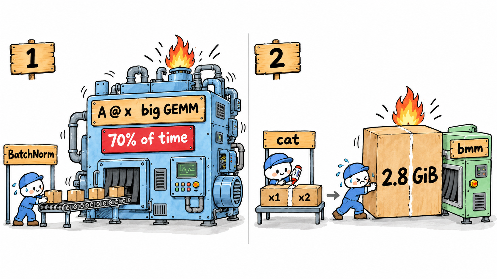
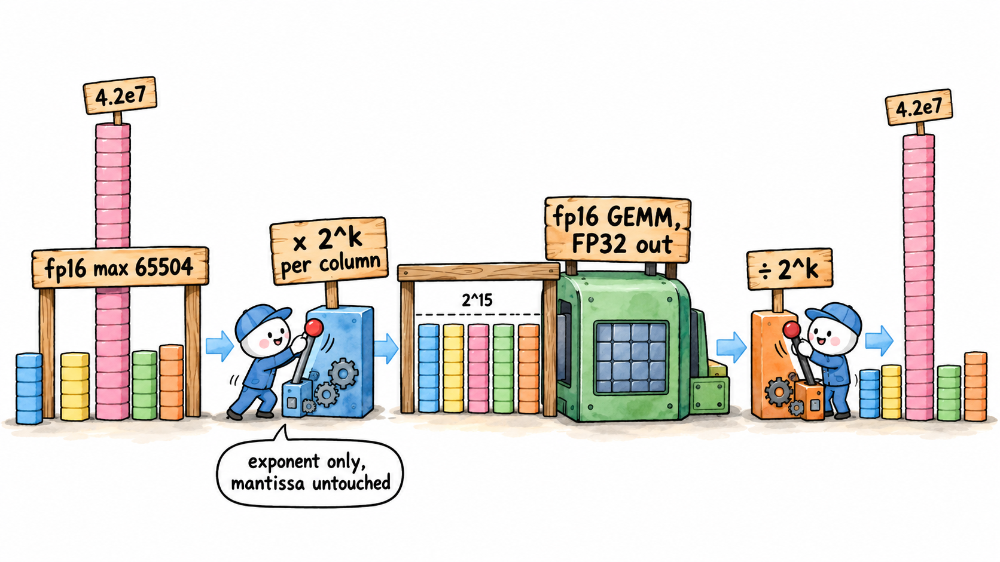
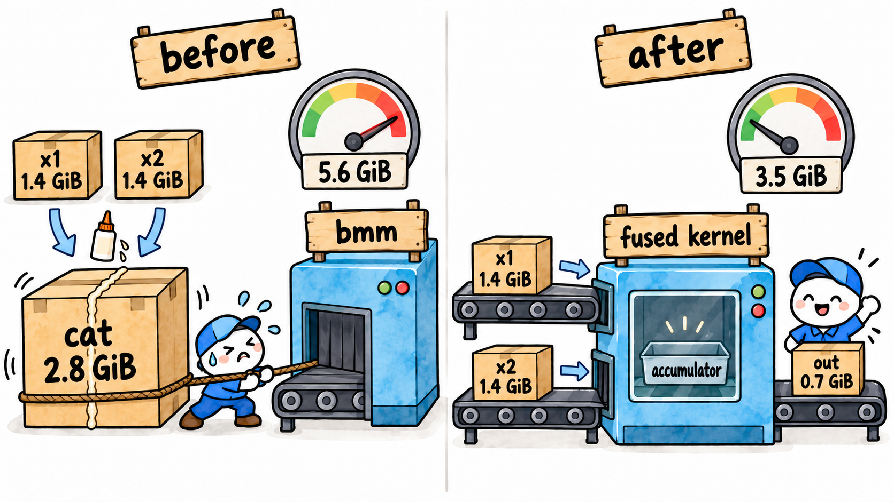

# 模型优化工程实践: fix BN带来的数值溢出与cat造成的显存尖峰问题

最近优化的一个模型里有这样两段, 注释里是真实数据下的维度:

```python
# 第一段: BN 之后接一个大矩阵乘
x = bn(h)                              # h, x: [4992, 75264]
y = A @ x                              # A: [4992, 4992], 每行是一组归一化权重; y 和 x 形状相同

# 第二段: 两个大矩阵 cat 之后过 linear
z = torch.cat([x1, x2], dim=-1)        # x1, x2: [4992, 147, 512]; z: [4992, 147, 1024]
out = torch.bmm(z.transpose(0, 1), W)  # W: [147, 1024, 256]; out: [147, 4992, 256]
```

<div align="center">
  
</div>

第一段代码的主要问题是bn带来的, 在数值精度上bn真的是毒瘤, 屡次害我. 
- 因为var方差太小, 导致这个bn会把数值放大350x, 实际测下来在fp16下会出现Inf/NaN, 被迫使用Fp32/TF32来跑. 实测下来多个 `A @ x` 叠加吃掉了整个模型七成的时间.
- 这个事情的根源是网络里有些 ReLU 在训练集上从没激活过, 对应的 BN 通道方差几乎为 0, 但咱是做推理的, 训练离咱们还有点距离

第二段的问题是cat的输出结果 z 单层就占 2.8 GiB 显存, 带来两个显著问题
- x1 x2 z三者要同时存在, 显存峰值占用会更高
- global memory写回量很高, cat本身几乎不做计算, 相当于是一个纯吃带宽操作, 最大的一个cat 3.5 ms, 4个合计 8.7 ms

节约大伙的阅读时间, 直接把结论放在最前面说:

- **BN + mm**: 大 GEMM 从 TF32 换到 fp16. BN 输出里有超过 fp16 上限的离群值, 用逐列 2 的幂缩放解决. 这个 GEMM 快 2 倍, 整个模型快 1.44 倍, 误差和 TF32 持平.
- **cat + bmm**: 写一个双输入的 Triton kernel, 拼接结果不落盘. 显存峰值增量 5.69 → 3.60 GiB, 虽然Triton性能不如cuBLAS, 但是由于节约了cat开销, 前向快 6%.

实验环境:

- GPU: NVIDIA A100 80GB PCIe
- PyTorch 2.16 + AOTInductor, 进程开启 TF32; 截止2026.10.16, 2.16版本的PyTorch需要拉取最新的开源main分支进行编译
- MFU 都按名义峰值算 (TF32 156, fp16/bf16 312 TFLOPS); 这张 PCIe 卡有 300 W 功耗墙, 跑满时频率从 1410 MHz 掉到约 1140 MHz, 实际上限大约是名义值的八成

---

## BN + mm: 让大 GEMM 跑在 fp16 上

### fp16 溢出了, 只好先用 TF32

最开始整个模型都想用 fp16, 结果有的 batch 输出整列 NaN. 毫无意外, 肯定又是BN出意外了 (上一次被它坑请参考 [BN Fold 在 BF16 下的精度问题与 Triton 融合实践](https://github.com/sujuyu/ZhangYu-s-Blog/tree/main/BN%20Fold%E5%9C%A8BF16%E4%B8%8B%E7%9A%84%E7%B2%BE%E5%BA%A6%E9%97%AE%E9%A2%98%E4%B8%8ETriton%E8%9E%8D%E5%90%88%E5%AE%9E%E8%B7%B5)).

eval 模式下 BN 就是一个逐通道的 affine:

$$
\mathrm{BN}(x) = (x-\mu)\cdot s + \beta, \qquad s = \frac{\gamma}{\sqrt{\sigma^2 + \epsilon}}
$$

开头代码里的 h 是一个 ReLU 的输出. 有些 ReLU 在整个训练集上都没被激活过, 输出恒为 0, 对应的 BN 通道 running_mean 和 running_var 都约等于 0, 也就是"死通道", 只占万分之一到千分之一. 这时 s 全靠 ε 托底 (PyTorch 默认 1e-5):

$$
s \approx \frac{\gamma}{\sqrt{\epsilon}} \approx 316\,\gamma
$$

训练时这些通道恒为 0, 放大多少倍都无所谓. 推理时只要来一个分布外的样本让这个 ReLU 输出非 0, BN 就把它放大三百多倍, 几层叠下来, 某些 batch 上 BN 输出能到 4.2e7. fp16 最大只能表示 65504, 转过去就是 inf; inf 进了 GEMM, `inf × 0 = NaN`, 整列都废了. 反倒是模型里直接作用在原始输入上的那个 BN 没有这种通道: 问题不在输入数据, 而在网络内部从没激活过的 ReLU.

`A @ x` 的输入正好就是 BN 的输出. 于是这部分退回 TF32: TF32 的指数位和 FP32 一样, 4.2e7 装得下.

### TF32 的代价

问题是 `A @ x` 太重了. 这个模型里有 4 个这样的 `A @ x`, 一次前向 118.7 ms, 它们占了 79.9 ms. 30 个同类模型统计下来, 它占 FLOPs 的 87%, 占耗时的 69% (中位数), cuBLAS 已经跑到 TF32 峰值的 76%, kernel 本身没什么油水了.

A100 上 TF32 Tensor Core 的稠密峰值是 156 TFLOPS, fp16/bf16 是 312 TFLOPS, 正好两倍. 想再快, 只能把它挪到 16 位上. 其余部分加起来只占三成, 保持原样: BN 仍是 FP32, linear 仍是 TF32.

### bf16 还是 fp16

| 格式 | 指数位 | 尾数位 | 最大值 | 单次舍入的相对误差 |
|---|---:|---:|---:|---:|
| TF32 | 8 | 10 | 3.4e38 | 2^-11 |
| bf16 | 8 | 7 | 3.4e38 | 2^-8 |
| fp16 | 5 | 10 | 65504 | 2^-11 |

bf16 装得下, 但尾数少 3 位, 每次舍入的误差是 TF32 的 8 倍; fp16 的尾数和 TF32 一样, 缺的只是范围. 拿真实输入单测 `A @ x` 这一步, 对 FP64 的相对 L2 误差:

| `A @ x` | 普通输入 (absmax 304) | 带离群样本的输入 (absmax 4.2e7) |
|---|---:|---:|
| TF32 | 1.93e-4 | 2.26e-4 |
| bf16 | 1.51e-3 | 1.55e-3 |
| fp16 | 1.92e-4 | inf / NaN |

带离群样本的那组来自另一个同类模型, x 是 [4992, 16640]. 两个模型各 4 个 `A @ x`, 8 组里 bf16 的误差都是 TF32 的 7~10 倍, fp16 和 TF32 基本一样. 所以选 fp16, 剩下的问题只有一个: 怎么让 4.2e7 装进 65504.

### 先让输出留在 FP32

新一点的 PyTorch 里, `torch.mm` 可以直接指定输出 dtype:

```python
y = torch.mm(A16, x16, out_dtype=torch.float32)   # 16 位读, FP32 累加, FP32 写
```

累加和输出都是 FP32, 输出端不会溢出, 也不会再被舍入成 16 位. Inductor 把它 lower 成 `aten.mm.dtype_out`, AOTI 里对应 C shim `aoti_torch_cuda_mm_dtype_out`, 底下还是 cuBLAS.

这样只剩输入要管. A 是归一化权重, 最大 0.17, 直接转 fp16 就行; 要处理的只有 BN 的输出 X.

### 逐列乘 2 的幂

AX 的第 j 列, 只由 X 的第 j 列决定:

$$
(AX)_{:,j} = A\,X_{:,j}
$$

所以每一列可以单独乘一个因子 s_j, 乘完再除回去. 写成矩阵:

$$
AX = \big(A\,(XD)\big)\,D^{-1}, \qquad D = \mathrm{diag}(s_1, \dots, s_N)
$$

这在实数上严格成立. s_j 取 2 的幂, 让每一列的最大绝对值落进 (2^14, 2^15]:

$$
a_j = \max_i |X_{ij}|, \qquad s_j = 2^{\,15 - \lceil \log_2 a_j \rceil}
$$

缩完的最大值不超过 32768, 离 65504 还有一倍余量.

为什么非得是 2 的幂: 浮点数乘 2^k 只改指数位, 尾数一位不动. 只要不跑出规格化范围:

$$
\mathrm{fp16}(x \cdot 2^k) = \mathrm{fp16}(x) \cdot 2^k
$$

于是 GEMM 里的每一项, 都只是原来的值整体乘了 s_j:

$$
\sum_k \mathrm{fp16}(A_{ik})\,\mathrm{fp16}(X_{kj} s_j) = s_j \sum_k \mathrm{fp16}(A_{ik})\,\mathrm{fp16}(X_{kj})
$$

两个 fp16 相乘在 FP32 里是精确的 (11 位 × 11 位 = 22 位, FP32 有 24 位), FP32 累加的每一步舍入也和乘 2^k 可交换, 最后除以 s_j 同样精确. 所以缩放版的结果, 和"假设 fp16 不会溢出"时直接转 fp16 算出来的完全一样: 输入按 fp16 舍入, 累加和输出是 FP32. 注意它不等于 FP32 GEMM 的结果: 输入的尾数还是只有 10 位, 和 TF32 一样, 所以误差和 TF32 同级. 这和 FP8 / MX 格式里的 block scaling 是一个思路, MX 格式每 32 个元素共享一个 E8M0 缩放因子, 也只有指数位. 实测在普通输入上, 加不加缩放, 99.9995% 的输出逐位相同, 剩下的差异小于 1e-6.

两个取舍, 做过低比特量化的同学应该觉得很小儿科了: 

- **缩放系数只能随列变, 不能随行变.** `A @ x` 是沿 X 的行 (k) 求和的. 同一列的所有行共用一个 s_j, s_j 才能从求和里整体提出来, 留在输出的第 j 列, 直接除掉; 如果系数随行变, 求和里每一项乘的倍数不一样, 就没法在输出上统一除回去.
- **逐列各缩各的, 不共用一个倍数.** 共用的话只能按最大的那列缩 2^11 倍, 最大值只有几百的正常列也被缩小 2048 倍, 一大片小值掉进 fp16 的非规格化区 (< 6.1e-5), 精度就丢了.

代码就三行, A 每次前向只转一次 fp16, 4 个 `A @ x` 共用:

```python
amax = x.abs().amax(dim=0).clamp_min(2.0 ** -100)               # 每列最大值, clamp 防全 0 列
scale = torch.exp2(15.0 - torch.ceil(torch.log2(amax)))         # s_j, 2 的幂
y = torch.mm(A16, (x * scale).half(), out_dtype=torch.float32) / scale
```

<div align="center">
  
</div>

上面的等价性有一个例外: 非规格化数. 缩放后一列只在最大值往下约 2^28~2^29 倍 (3~5 亿倍) 的范围内有完整精度, 再小就进非规格化区.

- 正常的列 s_j ≥ 1, 是放大, 小数值反而比直接转 fp16 表示得更好.
- 只有含离群值的列被缩小. 最坏的一列 (4.2e7, 缩小 2^11 倍) 里, 小于 0.125 的数精度变差, 小于 6e-5 的直接变 0, 绝对误差最多 6e-5. 这一列最大值自己的舍入误差就上万 (TF32 也一样), 这点损失可以忽略.

缩放本身也有开销: 每个 `A @ x` 前多读一遍 X 求列最大值, 再读写一遍做缩放. 一次前向的逐元素部分多了 4.5 ms; 多出来的 fp16 副本没有抬高显存峰值.

### 结果

精度, 模型整体输出对 FP32 的相对 L2 误差:

| `A @ x` | 普通输入 | 带离群样本的输入 |
|---|---:|---:|
| TF32 (原来) | 1.59e-3 | 7.29e-4 |
| bf16 | 1.67e-3 | 7.32e-4 |
| fp16 直接转 | 1.60e-3 | 1 列 NaN |
| fp16 逐列缩放 | 1.60e-3 | 7.28e-4 |

整体输出的误差大头来自其他 TF32 层, `A @ x` 用 bf16 多出来的误差被稀释了不少. 换 3 批输入、78 个模型实例统计逐列误差, 和 TF32 比: fp16 逐列缩放是 0.98~1.03 倍, bf16 中位多 8%~13%, 最多多 55%. 放到下游任务上, 整个 batch 里排前 2% (约 100 个) 的样本, fp16 缩放版的重合率维持在 98% 左右, 和 TF32 一样.

速度, 同一批真实输入:

| `A @ x` | 整个模型前向 | 其中 `A @ x` | `A @ x` 的 MFU | 30 个同类模型合计 |
|---|---:|---:|---:|---:|
| TF32 | 118.7 ms | 79.9 ms | 75% (峰值 156) | 2224 ms |
| bf16 | 79.1 ms | 40.0 ms | 75% (峰值 312) | 1495 ms, 1.49x |
| fp16 逐列缩放 | 81.8 ms | 38.4 ms | 78% (峰值 312) | 1543 ms, 1.44x |

`A @ x` 快了一倍, MFU 没掉, 整个模型快 1.44 倍. bf16 省掉了缩放那两遍读写, 再快 3%, 但换不回精度.

---

## cat + bmm: 融合算子避免cat结果写回global memory

### cat 把显存吃了

回到开头的第二段. x1 和 x2 形状相同, 没有广播, cat 只是把它们并排摆好. 但 Inductor(torch.compile) 会老老实实把 z 写进显存, bmm 再读回来:

```text
x1      [4992, 147, 512]   FP32   1.40 GiB
x2      [4992, 147, 512]   FP32   1.40 GiB
z       [4992, 147, 1024]  FP32   2.80 GiB   <- cat 的结果
out     [147, 4992, 256]   FP32   0.70 GiB
```

cat 执行时 x1、x2、z 同时活着, 一共 5.60 GiB, 再加上 0.09 GiB 的其他 tensor, 正好是实测的显存峰值增量 5.69 GiB (预热后单次前向的 `max_memory_allocated` 增量, 不含权重和输入). 这个模型里有 4 处这样的 cat, 光 cat kernel 一次前向就要 8.7 ms. 最大的一个 3.5 ms, 读写共 5.6 GiB, 带宽 1.73 TB/s, 已经接近 A100 的 1.94 TB/s, 纯在搬数据.

### 把权重切开, cat 就没了

W 沿输入维切成上下两半:

$$
[X_1,\ X_2]\,W = X_1 W_1 + X_2 W_2, \qquad W = \begin{bmatrix} W_1 \\ W_2 \end{bmatrix}
$$

先用 PyTorch 原生算子试两种写法:

| 写法 | 前向 | 显存峰值增量 |
|---|---:|---:|
| cat + bmm (原来) | 118.3 ms | 5.69 GiB |
| bmm + bmm + add | 114.5 ms | 4.29 GiB |
| bmm + baddbmm | 117.8 ms | 3.60 GiB |

- 两次 bmm 再相加: cat 没了, add 也融进了后面的 relu, 但两个 bmm 的输出要同时存在, 显存只降了 25%.
- baddbmm 把第二个乘积累加到第一个上, 显存降到底了. 但它在 AOTI 里不是原地累加, 每处多一次 DtoD 拷贝, 4 处共 3.5 GiB, 速度基本没变.

找寻世间双全法, 还是得自己写: 一个 kernel 读两个输入, 共用一个 fp32 accumulator 累加器, 最后只写一次输出.

<div align="center">
  
</div>

### 双输入 Triton kernel

```python
@triton.jit
def round_tf32(x):
    # 和 cuBLAS 一样就近舍入到 TF32, 不让 Tensor Core 直接截断 FP32
    # 用脚想也知道这段汇编肯定是claude opus5.5想出来的
    return tl.inline_asm_elementwise(
        "{ .reg .b32 r; cvt.rna.tf32.f32 r, $1; mov.b32 $0, r; }",
        constraints="=f,f", args=[x],
        dtype=tl.float32, is_pure=True, pack=1,
    )


def round_weight_tf32_(w):
    # 权重是常量, 加载模型时先就近舍入好 (低 13 位加半个 ulp 再清零), kernel 里只舍入激活
    w.view(torch.int32).add_(0x1000).bitwise_and_(-0x2000)
    return w


@triton.jit
def projection_kernel(H, G, W, O, B, K: tl.constexpr, N: tl.constexpr,
                      HM: tl.constexpr, HB: tl.constexpr, HK: tl.constexpr,
                      GM: tl.constexpr, GB: tl.constexpr, GK: tl.constexpr,
                      WM: tl.constexpr, WK: tl.constexpr, WN: tl.constexpr,
                      BB: tl.constexpr, BN: tl.constexpr, BK: tl.constexpr):
    m = tl.program_id(2)                                 # bmm 的第 m 个矩阵
    rows = tl.program_id(1) * BB + tl.arange(0, BB)
    cols = tl.program_id(0) * BN + tl.arange(0, BN)
    kk = tl.arange(0, BK)
    acc = tl.zeros((BB, BN), tl.float32)
    for start in range(triton.cdiv(K, BK)):              # 前半: x1 @ W_1
        k = start * BK + kk
        a = tl.load(H + m * HM + rows[:, None] * HB + k[None, :] * HK,
                    (rows[:, None] < B) & (k[None, :] < K), other=0)
        w = tl.load(W + m * WM + k[:, None] * WK + cols[None, :] * WN,
                    (k[:, None] < K) & (cols[None, :] < N), other=0)
        acc = tl.dot(round_tf32(a), w, acc, input_precision="tf32")
    for start in range(triton.cdiv(K, BK)):              # 后半: x2 @ W_2, 累加进同一个 acc
        k = start * BK + kk
        a = tl.load(G + m * GM + rows[:, None] * GB + k[None, :] * GK,
                    (rows[:, None] < B) & (k[None, :] < K), other=0)
        w = tl.load(W + m * WM + (K + k[:, None]) * WK + cols[None, :] * WN,
                    (k[:, None] < K) & (cols[None, :] < N), other=0)
        acc = tl.dot(round_tf32(a), w, acc, input_precision="tf32")
    tl.store(O + m * B * N + rows[:, None] * N + cols[None, :], acc,
             (rows[:, None] < B) & (cols[None, :] < N))
```

几个细节:

- grid 是 `(输出列块, 行块, m)`, m 对应 bmm 里的 147 个矩阵, 每个 program 算其中一个矩阵的一个 `BB×BN` 输出块. 两段 K 循环往同一个 FP32 accumulator 里累加, 拼接结果只在寄存器里出现过.
- H、G 分别指向 x1 和 x2, 按 stride 读. 它们在显存里是 `[B, M, C]`, 直接传 `transpose(0, 1)` 的视图, 不用先转成连续.
- tile 扫了 100 多组配置, 三种尺寸最快的都是 `BN=256`: 对 N=256 的层, 一个 tile 就盖住整个输出宽度, 每行输入只读一遍, 一开始用的 `BN=128` 要读两遍. 最后选的 `(BB, BN, BK, warps, stages)` 是 `(128, 256, 16, 8, 4)` / `(128, 256, 32, 8, 3)` / `(64, 256, 16, 4, 4)`, 分别对应 K×N 为 512×512 / 1024×256 / 512×256 的层.
- **TF32 做四舍五入(claude opus 5.5 🐮).** Triton 的 tf32 dot 把 FP32 直接喂给 Tensor Core, 低 13 位被丢掉, 相当于截断; cuBLAS 是先就近舍入. 不加 `cvt.rna.tf32.f32` 的话一个元素都对不上, 对 FP64 的误差是 cuBLAS 的 2.6 倍 (7.7e-4 对 2.9e-4); 加上以后和 cuBLAS 的 cat + bmm 逐位相同, 换 kernel 不引入任何数值变化. 它没法比 FP32 更准 (不开 TF32 时误差是 5e-7), 只是把 TF32 该有的精度拿回来. bmm 右边的权重 W 是常量, 可以在加载模型时提前舍入好 (舍入两次结果不变), kernel 里只舍入每次都变的激活 x1、x2, 省掉大部分舍入指令.

### 结果

4 组 cat + bmm 变成 4 个 kernel. 先单独测这 4 处的合计:

| | 耗时 | GEMM 的 MFU |
|---|---:|---:|
| cuBLAS cat + bmm (原来) | 22.0 ms | 59%~65% (只算 bmm) |
| Triton, 一开始的 tile (`BN=128`) | 16.2 ms | 44%~48% |
| Triton, `BN=256` 的 tile | 14.3 ms | 51%~54% |
| Triton, `BN=256` + 权重提前舍入 | 13.3 ms | 55%~57% |

Triton 的 GEMM 本身还是比 cuBLAS 慢 10% 左右 (cuBLAS 只做 bmm 是 12.0 ms), 但 cat 没了, 这 4 处合起来快了 40%. 放回整个模型: 前向 118.3 → 111.3 ms, 快 6%; 显存峰值增量 5.69 → 3.60 GiB, 降了 37%, 和上面的预估结果对得上 (1.40 + 1.40 + 0.70 + 0.09). 这批真实输入上, 输出和原来逐位一致.

---

## 小结

- bn 误我
- write back 也误我
