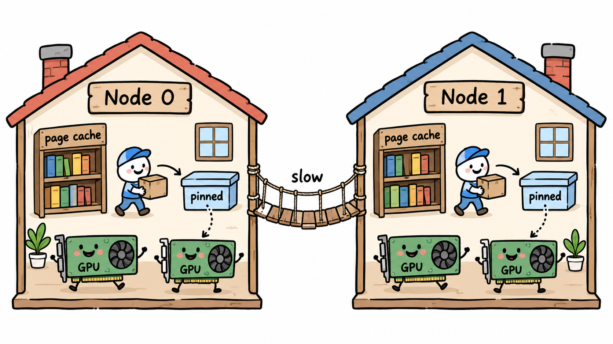
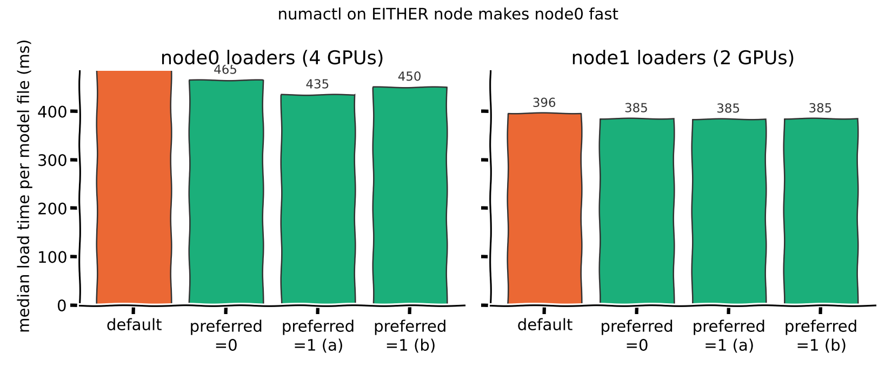
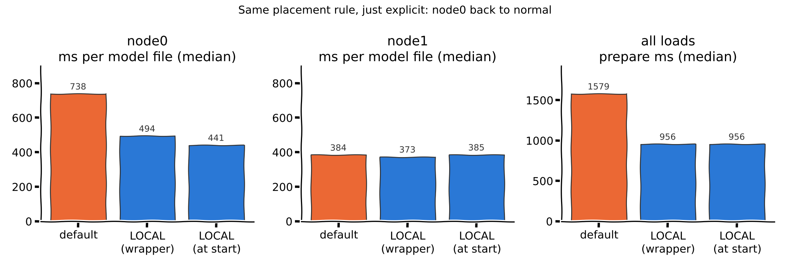
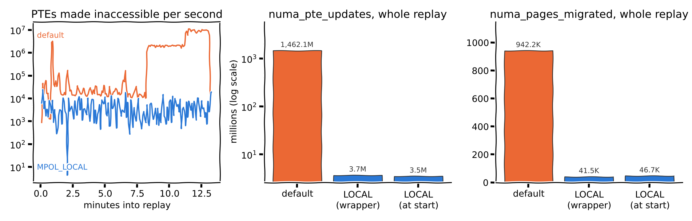
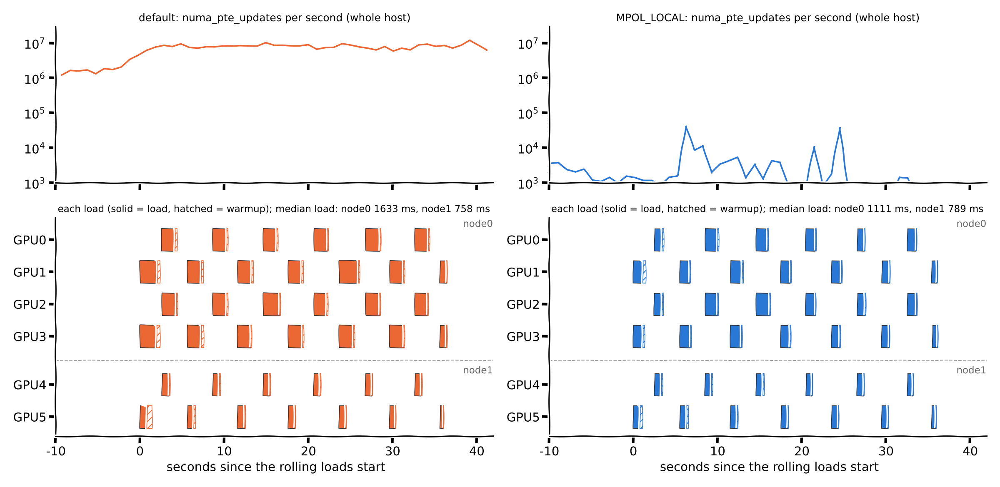
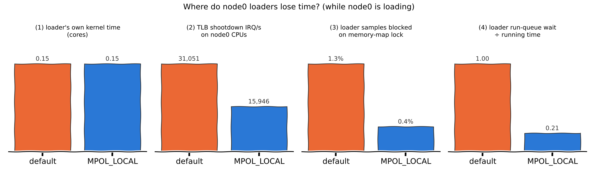
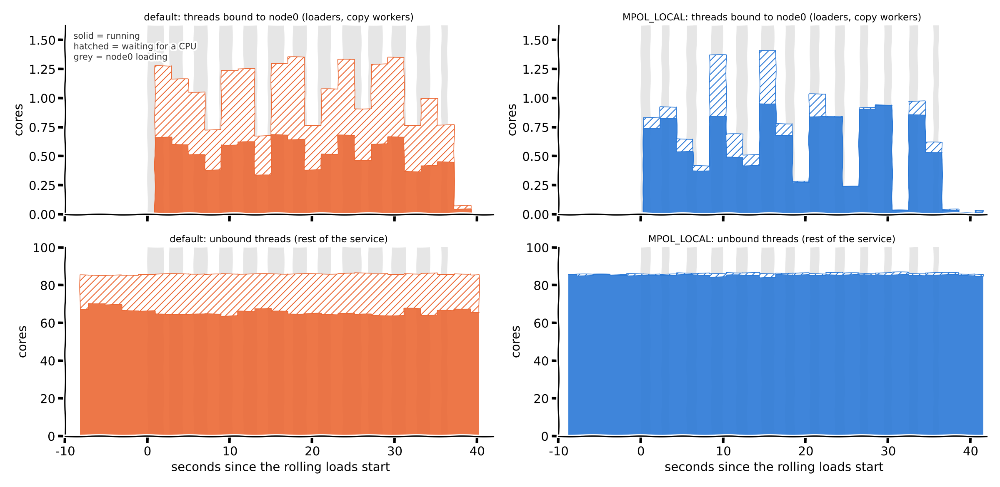
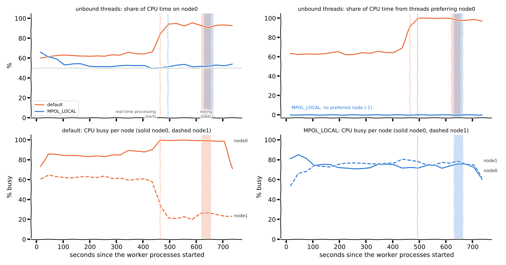
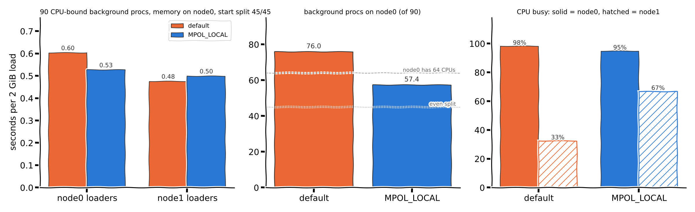

## NUMA自动均衡的副作用: 线程向热数据扎堆, 绑核的任务反而变慢

最近实现一个在线推理服务的模型**快速上下线**时, 遇到了一个NUMA相关的corner case: 在双路机器上密集地把数据从page cache搬运到pinned memory buffer块, 再从pinned memory buffer搬运到显存, 即使线程、内存和 GPU 都绑在了同一个 NUMA node 上, 内核默认开着的 NUMA 自动均衡 (numa balancing) 仍然可能拖慢搬运. 

> 一句话: 当热数据集中在一个 node 上, 又有大量没绑核的 CPU 密集线程在频繁访问它时, Linux 的 NUMA 自动均衡会按"离数据近"把这些线程陆续拉到这个 node, 普通的负载均衡也不再把它们挪开. 结果这个 node 的 CPU 被挤满, 另一个 node 大半空闲: 整机 CPU 并没有用满, 只是分布不均. 绑在这个 node 上的任务走不掉, 只能排队等 CPU, 我们 node0 上的模型加载因此慢了约 67%. 解决办法很简单: 进程一启动就显式设置一个内存策略 (`MPOL_LOCAL`), 自动均衡就会跳过这个进程. 

文中用三种标记区分证据强度(opus5.5干的):

- 📏 实测: 直接量出来的数
- 🔬 干预实验: 只改一个变量、结果跟着变, 可以算因果
- 🤔 推断: 有证据支持, 但没有直接测到

### 场景: 双路机器上的密集搬运

机器是一台双路服务器, 装了 2 颗 AMD EPYC 7H12, 每颗 64 核, 没开超线程, 一共 128 核. 它分成 2 个 NUMA node, 可以先把每个 node 理解成一组 CPU 核加上离它们最近的那部分内存, 每个 node 约 1 TiB 内存. 另有 6 张 A100 80GB PCIe, 其中 4 张挂在 node0 下, 2 张挂在 node1 下. 

服务运行时需要频繁地上下线模型: 把模型文件 (每个约 5 GiB) 从 page cache 拷到 pinned memory, 这一步是 host 内存之间的拷贝 (H2H); 再从 pinned memory 拷到 GPU, 这一步是 host 到 device 的拷贝 (H2D). 一轮线上流量回放下来要搬大约 397 GiB 📏. 

跨 node 访问内存很贵, 以前我潜意识里面, 跨node访问我一般认为带宽和时延会减半, 这次可能是因为AMD zen2或者DDR4比较旧的原因, 在这台机器上, 同 node 的 host 内存拷贝能跑到 116.8 GiB/s, 跨 node 只有 36.8 GiB/s 📏. 所以我们给每张卡配了一个 loader (模型加载) 线程, 把它的 CPU 亲和和内存策略 (`MPOL_BIND`) 都绑在卡所在的 node 上, page cache 由同 node 的线程预读, pinned memory 也按 node 分池. 

<div align="center">
  
</div>

需要稍微提一下的是: PyTorch 的 CachingHostAllocator 缓存不区分 node, node1 的线程会一直复用 node0 线程释放的 pinned block, 绑核绑得再好也拿不到本地内存. 我们为此提了 [pytorch/pytorch#197868](https://github.com/pytorch/pytorch/pull/197868), 通过 opt-in 开关 `pinned_numa_aware` 让空闲的 pinned block 按 node 分开缓存, 详细的测量见 PR. 

到这一步, 我们以为搬运在 NUMA 层面已经"绑干净"了. 

### 现象: node0 比 node1 慢一倍

然而回放下来, 两个 node 的加载耗时差得离谱. 下面是一轮回放里, 每个模型文件从 page cache 搬到 GPU 并加载完成的耗时中位数 📏:

| | node0 (4 张卡) | node1 (2 张卡) |
|---|---:|---:|
| 每个模型文件的加载耗时 (中位数) | 738 ms | 384 ms |

node0 挂了 4 张卡, node1 只挂了 2 张, node0 忙一些是正常的. 但后面会看到, 修好之后 node0 降到了 441 ms, 和 node1 的 385 ms 只差 15%, 所以这一倍的差距大部分不是卡数不对称造成的. 

把耗时折算成吞吐, node0 每张卡端到端只有约 6.8 GiB/s, node1 约 13 GiB/s 📏; 单卡独立测试时, pinned → GPU 的 H2D 能跑到约 24 GiB/s 📏. 不过, 多张卡不能各自独享这个速度: page cache → pinned memory 需要一次读、一次写, 随后的 H2D 还要再读一次, 都在共享同一个 node 的内存带宽. 按每颗 CPU 八通道 DDR4-3200 满速配置的理论读写合计带宽 (204.8 GB/s, 约 190.7 GiB/s) 粗算, 忽略缓存复用和其他开销, 每个 node 最多支撑约 63.6 GiB/s 的模型数据搬运, node0 四张卡同时均分约为每卡 15.9 GiB/s. 实际速度仍有差距, 但仅凭这些数字还不能排除带宽瓶颈. 那么, 时间究竟花在了搬运上, 还是其他地方? 

### 线索: numactl 指哪个 node 都快

我们试着用 `numactl --preferred=N` 启动整个服务, 让内存优先从指定 node 分配, 想看看内存偏向 node1 会不会让 node1 更快. 结果让人摸不着头脑 (这是更早的一批回放, 默认情况下 node0 是 779 ms) 📏:

<div align="center">
  
</div>

- 不加 numactl: node0 每个文件 779 ms
- `--preferred=0`: node0 降到 465 ms
- `--preferred=1`: node0 降到 435 / 450 ms (跑了两轮)

node1 则一直在 385 ~ 396 ms, 没什么变化. 

不管指向哪个 node, node0 都变快了. 如果问题是"内存放错了 node", 那 `--preferred=0` 和 `--preferred=1` 应该一个变好一个变坏才对. 两边都变好, 说明关键不在于"放在哪", 而在于"有没有设". 

<div align="center">
  
</div>

### MPOL_LOCAL

我们想保持内存的放置规则不变, 只改变"是否显式设置了策略". Linux 恰好有这样一个策略: 进程默认的策略是 `MPOL_DEFAULT`, 按 first-touch 放置, 也就是哪个线程第一次访问一页内存, 就从这个线程所在的 node 分配; 而 `MPOL_LOCAL` 显式要求"从分配线程所在的 node 分配", 规则和默认一样. 

在进程入口最早的位置加上几行 (必须早于任何线程创建, 线程和子进程会继承创建者当时的策略):

```Python
import ctypes, os

libnuma = ctypes.CDLL("libnuma.so.1", use_errno=True)
libnuma.set_mempolicy.argtypes = (ctypes.c_int, ctypes.c_void_p, ctypes.c_ulong)
if libnuma.set_mempolicy(4, None, 0) != 0:  # 4 = MPOL_LOCAL
    err = ctypes.get_errno()
    print("set_mempolicy(MPOL_LOCAL) failed:", os.strerror(err))
```

loader 线程之后照样用 `MPOL_BIND` 覆盖成自己卡所在的 node, 不受影响. 

我们试了两个设置位置: 一是写一个很小的启动包装器, 先设好策略再用 `exec` 启动服务 (策略会跨 exec 保留); 二是像上面这样写在服务进程的入口. 同一份代码连续做对照回放, 只改变这一个设置, 效果如下 🔬:

<div align="center">
  
</div>

| | 默认策略 | MPOL_LOCAL (启动包装器) | MPOL_LOCAL (进程入口) |
|---|---:|---:|---:|
| node0 每个文件加载 (中位数) | 738 ms | 494 ms | 441 ms |
| node1 每个文件加载 (中位数) | 384 ms | 373 ms | 385 ms |
| 一次上线准备 (中位数 / 最大) | 1579 / 2290 ms | 956 / 1492 ms | 956 / 1266 ms |

放置规则完全没变, node0 却回到了正常水平, node1 纹丝不动. 

顺带提两个小坑:

1. `numactl --localalloc` 不一定等于 MPOL_LOCAL. 在我们这台机器的 numactl (2.0.12) 上, `--localalloc` 实际设下去的是 `MPOL_DEFAULT` (用 `get_mempolicy` 读回来 mode 是 0), 和不设没有区别. 想要显式的本地策略, 最稳妥的是像上面那样直接调 `set_mempolicy`. 另外, 用 `get_mempolicy` 验证时, MPOL_LOCAL 在 5.4 内核上会读成 mode 1, 这是正常的. 
2. 容器里要有 `CAP_SYS_NICE`. Docker 默认的 seccomp 规则只在容器具备 `CAP_SYS_NICE` 时才放行 `set_mempolicy` / `mbind` / `get_mempolicy`, 否则会返回 EPERM. `docker run --cap-add SYS_NICE` 即可. 

### 被忽略的主角: NUMA 自动均衡

那么"显式"和"默认"到底差在哪? 答案是内核的 NUMA 自动均衡 (automatic NUMA balancing). 

我们没有手动打开过它. 在这台 Ubuntu 20.04 (5.4 内核) 机器上, 内核编译配置就是 `CONFIG_NUMA_BALANCING_DEFAULT_ENABLED=y`, 启动参数和 sysctl 配置也没人改过, 只要机器有多个 node 就会生效:

```bash
$ cat /proc/sys/kernel/numa_balancing
1
```

它不是 first-touch 的替代, 而是叠加在 first-touch 之上的"事后纠正": 页一开始仍然按 first-touch 放, 之后内核持续采样, 发现放错了就把页搬过去, 或者把线程挪过去. 

内核怎么知道"哪个线程在访问哪一页"? 硬件不会告诉它, 所以它人为制造缺页来采样:

<div align="center">
  
</div>

1. **扫描**: 内存是按页管理的, 通常一页 4 KiB. 内核隔一段时间就把进程的一批页标成"不可访问". 页本身没动, 数据还在原地. 
2. **陷入**: 线程再访问这些页时, 会先暂停, 转给内核处理. 内核认出这是扫描时做的标记, 记一笔"谁访问了哪个 node 上的页", 再让线程继续执行. 这次缺页叫 NUMA hint fault, 它不影响程序的计算结果. 
3. **搬页 / 挪线程**: 内核根据这些记录, 把页搬到常访问它的 node, 或者把线程挪到它常访问的内存所在的 node. 

这里和前面的实验对上了: 自动均衡只处理默认策略的线程, 任何显式的内存策略 (`MPOL_LOCAL`、`MPOL_BIND`、`MPOL_PREFERRED` ...) 都会让它跳过. 所以 numactl 指哪个 node 都快, 起作用的不是"指向哪", 而是"有没有显式策略". 

### 让 Claude 帮忙排查: 扫描量差了 400 倍

我让 Claude 在两组回放前后及回放期间采集了 `/proc/vmstat` 里的 NUMA 计数, 看扫描量有没有随策略变化:

<div align="center">
  
</div>

| 一轮回放 (整机计数) | 默认策略 | MPOL_LOCAL (启动包装器) | MPOL_LOCAL (进程入口) |
|---|---:|---:|---:|
| `numa_pte_updates` | 14.6 亿 | 372 万 | 353 万 |
| `numa_pages_migrated` | 94.2 万 | 4.2 万 | 4.7 万 |

差了约 400 倍 📏. 从左边的时间线能看到, 默认策略下的扫描在回放后半段 (模型滚动加载最密集的时候) 冲到了每秒两百万, 最后几分钟接近每秒一千万. MPOL_LOCAL 下剩下的那几百万, 应该是机器上其他进程的背景值 (计数器是整机的). 

再看扫描的结果. 另一轮默认策略回放记录了 873 万次 hint fault, 其中 92.8% 访问的页本来就在访问线程所在的 node 上 📏. 也就是说, first-touch 基本把页放对了, 需要搬的页很少 (下面会算到, 搬页量还不到数据搬运量的 1%). 但这些 hint fault 记录还有另一个用处: 内核据此给每个线程定一个偏好 node, 再把线程往那里挪. [后面"慢不在扫描本身"一节](#慢不在扫描本身-而在挤)会看到, 真正出问题的是这一步. 

搬页会不会抢了数据搬运的带宽? 从这轮数据看可以排除: 整轮回放搬了 94.2 万页, 按 4 KiB 算约 3.6 GiB, 摊在 13 分钟里约 4.6 MiB/s. 计数器是整机的, 还包含其他进程, 所以 3.6 GiB 已经是上限; 而同一轮我们自己搬运了 397 GiB, 3.6 GiB 还不到它的 1% 📏. 

> 注: `numa_pte_updates` 和 `numa_pages_migrated` 都按 4 KiB 页计数, 一个 2 MiB 大页会记成 512. 所以上面这些数字适合拿来比较两组, 不代表内核实际标记或搬动了多少次. 

把时间轴放大到模型滚动加载的那 40 秒, 能看到扫描和加载是同时发生的. 图中每个色块代表一次加载, 通常包含 2 个模型文件. 这两轮回放还同时挂着采集线程状态的采样器 (下一节会用到它的数据), 采样本身会拖慢加载, 所以耗时比前面的表格长:

<div align="center">
  
</div>

默认策略下, 加载开始前扫描是每秒一百多万次, 滚动加载一开始就跳到每秒八百万次左右, 最高一千万, 之后一直维持在这个水平. MPOL_LOCAL 下扫描一直在每秒一两千次, 偶尔冒到几万 📏. 

同一时段里, 默认策略和 MPOL_LOCAL 下 node0 每次加载耗时的中位数分别是 1633 ms 和 1111 ms; node1 分别是 758 ms 和 789 ms, 两组差不多 📏. 

### 慢不在扫描本身, 而在"挤"

扫描是怎么拖慢 loader 的? 我们一开始列了三个候选:

1. 扫描由进程自己的线程执行, loader 可能被轮到, 忙着把一批页标成"不可访问"
2. 标记之后, 内核要发中断, 让其他 CPU 清掉缓存的地址映射 (这叫 TLB shootdown), loader 可能因此被打断
3. 扫描期间, 内核要持有一把管理进程内存映射的锁, loader 加载动态库 (.so 文件) 时也可能要用这把锁, 只能等待

为了分别检查这三条路, Claude 起了一个辅助采样容器 (sidecar, 用 `--pid=host --privileged` 读宿主机的 `/proc`): 每秒采各个 node 的 TLB shootdown 中断数, 每 20 ms 采一次 loader 线程的内核调用栈 (`/proc/<tid>/stack`), 每 2 秒采每个线程的调度统计 (`/proc/<tid>/schedstat`). 两组代码相同, 只改内存策略. 采样本身会拖慢加载, 所以下面只比较两组之间的差别. 

结果有点出乎意料, 三条都量到了, 但都很小:

<div align="center">
  
</div>

| 途径 | 默认策略 | MPOL_LOCAL | 判断 |
|---|---:|---:|---|
| (1) node0 loader 自己的内核态 CPU | 0.15 核 | 0.15 核 | 排除, 没有差别 📏 |
| (2) node0 CPU 上的 TLB shootdown 中断 | 3.1 万/s | 1.6 万/s | 多出来的 1.5 万次摊到 64 个核, 每核每秒约 240 次, 按每次几微秒估算只占约 0.1% 量级的 CPU, 可忽略 📏 |
| (3) loader 卡在内存映射锁上的采样比例 | 1.3% | 0.4% | 存在但很小 📏 |
| (4) loader 线程累计排队时间 ÷ 累计运行时间 | **1.00** | **0.21** | 和变慢同步 📏 |

第 4 条是我们一开始没列进去的: loader 线程已经可以运行了, 却没有空闲的 CPU 给它. 它绑在 node0 的 64 个核上, 只能在那里排队. 这个比值是累计出来的: 在 node0 加载的那 40 秒左右里, 默认策略下绑在 node0 上的线程 (loader 和它的拷贝线程) 累计运行了 19.8 秒, 累计排队也是 19.8 秒, 想运行的时间里有一半在排队; MPOL_LOCAL 下是累计运行 21.0 秒、排队 4.4 秒, 排队约占 17% 📏. 这些排队时间是很多次短暂的排队加起来的, 不是某一次等了 1 秒. 打个比方, 两个线程挤在一个核上轮流跑, 每人跑一个时间片 (这台机器上约十几毫秒) 就换对方, 每秒各运行约 0.5 秒、排队约 0.5 秒, 比值就是 1.0, 可每次排队只有十几毫秒. 

把"运行"和"排队"画成时序图更直观. 下图分别汇总一组线程每 2 秒的运行时间和排队时间, 再除以 2 秒, 换算成"核数": "运行 0.5 核"表示这组线程每秒合计运行了 0.5 秒; 排队也按同样的方法换算, 表示每秒合计排队了多久, 并没有真的占用 CPU. 上排是绑在 node0 上的线程 (loader 和它的拷贝线程), 下排是服务里其他没绑核的计算线程. 服务容器里最多同时有 107 个进程, 这些线程就分布在其中:

<div align="center">
  
</div>

- 上排: 图示时段内, 默认策略下 node0 线程的排队 (斜线) 和运行 (实心) 差不多一样高, 排队时间与运行时间之比是 1.02, MPOL_LOCAL 下是 0.19 📏. 上表只统计 node0 正在加载的时段, 所以比值是 1.00 和 0.21. 
- 下排: 两组未绑核线程的运行 + 排队合计都约 86 核, 整机有 128 核, 总量没满 📏. 但默认策略下一直有 17 ~ 21 核的线程在排队, 加载开始之前就是这样; MPOL_LOCAL 下只有 0.1 ~ 1 核 📏. 默认策略下这些线程在 CPU 之间迁移的次数也多得多, 每秒 1458 次, MPOL_LOCAL 下是 741 次 📏. 

总量没满却持续排队, 说明 CPU 不是不够用, 而是忙闲不均. 和 loader 抢 CPU 的是服务自己那些没绑核的计算线程, 不是机器上的其他程序, 后者只占几个核, 两组一样. loader 只能在 node0 的核上跑, 它在排队, 说明 node0 挤; 服务这些线程的需求约 86 核, 加上其他程序也用不满 128 核, 说明 node1 还有空闲. 这种状态在加载开始前就已存在, loader 被绑在 node0, 去不了 node1, 需要 CPU 时只能等. 

那些线程为什么会挤在 node0? 我们又跑了一组对照回放, 这次每 2 秒记录服务里每个线程当前跑在哪个核上、内核给它定的偏好 node (`numa_preferred_nid`, 在 `/proc/<pid>/task/<tid>/sched` 里), 以及它的运行和排队时间:

<div align="center">
  
</div>

| 没绑核的线程 | 默认策略 | MPOL_LOCAL |
|---|---:|---:|
| 结束前偏好 node0 的线程 | 96 / 99 | 0 (全部没有偏好) |
| CPU 时间落在 node0 的比例 (整轮 / 滚动加载期间) | 73.0% / 91.7% | 53.3% / 51.9% |
| 滚动加载期间 node0 / node1 的 CPU 忙碌度 | 98.9% / 26.9% | 76.1% / 78.1% |
| node0 每个模型文件的加载 (中位数) | 817 ms | 452 ms |
| node0 loader 累计排队 ÷ 累计运行 | 0.98 | 0.02 |

默认策略下, 这种偏是慢慢攒出来的 📏: worker 进程起来后的 7 分多钟里, 这些线程有六成多的 CPU 时间在 node0, 两个 node 都没满; 在服务开始处理实时请求 (图中的竖虚线) 前后的一分多钟里, 几乎所有线程的偏好都变成了 node0, CPU 时间跟着挤了过去, node0 忙到 99% 以上, node1 只剩两成左右, 十几个核的线程开始排队. 后面的模型滚动加载正好撞在这段时间里. MPOL_LOCAL 下所有线程都没有偏好 node, 两个 node 各分到一半左右的 CPU 时间, 忙碌度也差不多 📏. 这两组回放也挂着采样器, 所以加载耗时和前面的表格不能直接比, 只看两组之间的差别. 

这里要分清两种"偏":

- 内存一开始就偏在 node0, 和自动均衡无关: 容器里约 35 GiB 的文件页, 两组都有 97% 以上在 node0; 服务主进程的内存 99.9% 在 node0 (默认策略下用 numa_maps 测的) 📏. 
- 线程和 CPU 的偏, 是自动均衡随着时间造出来的: 没有它的时候, 普通的负载均衡会把 CPU 负载摊平, 就是 MPOL_LOCAL 那组 📏; 有了它, 线程被拉向自己的偏好 node, 负载均衡也不太愿意把线程从偏好 node 上挪走 (这是调度器的设计, 我们没有单独测). 线程跑到哪, first-touch 就把它新分配的内存放到哪: 默认策略下, 线程自己的匿名内存 96% 以上在 node0, MPOL_LOCAL 下大部分时间只有 43% ~ 48% 📏. 

<div align="center">
  
</div>

至于偏好为什么偏偏在开始处理实时请求前后集体翻向 node0, 我们没有细查 🤔. 那段时间容器的匿名内存多了 2 GiB 多, 新增的部分几乎都在 node0, 可能和这些线程开始访问新的数据有关. 

### 一个两 node 对称的最小复现

真实服务里 node0 挂 4 张卡、node1 挂 2 张, 本身就不对称. 为了确认这个现象不依赖卡数不对称, 我写了一个独立的小脚本 ([scripts/repro_numa_balancing.py](scripts/repro_numa_balancing.py)), 在同一台机器上让两个 node 的 GPU 和 loader 配置完全对称:

- node0 和 node1 各用 2 张 GPU, 每张卡一个 loader 线程, CPU 亲和 + `MPOL_BIND` 绑在自己的 node 上, 循环做 `2 GiB 文件 (page cache, 同 node) --read()--> pinned buffer --H2D--> GPU`
- 另起 90 个吃 CPU 的后台进程, 模拟服务里没绑核的计算线程: 它们不绑核, 每个进程 256 MiB 的工作内存落在 node0 (模拟"大部分内存在 node0"), 起跑时 node0、node1 各 45 个
- 两组只差一件事: 进程启动时是否 `set_mempolicy(MPOL_LOCAL)` (后台进程是 fork 出来的, 会继承). 每轮计时 90 秒, 两组交替各跑两轮

后台进程必不可少: loader 都是 `MPOL_BIND`, 自动均衡不会处理它们, 不起后台进程时 4 个 loader 都在 481 ~ 518 ms, 完全对称 📏. 起跑对半分, 是为了不让起跑位置本身造成扎堆: 如果全从 node0 起跑, 即使设了 MPOL_LOCAL, 80 个后台进程里也有 58 ~ 60 个一直留在 node0 📏. 

结果 🔬:

<div align="center">
  
</div>

| 90 秒计时窗口 | 默认策略 (两轮) | MPOL_LOCAL (两轮) |
|---|---:|---:|
| `numa_pte_updates` | 5562 万 / 5991 万 | 7.9 万 / 10.8 万 |
| 后台进程里 `numa_preferred_nid` = 0 的个数 | 79 / 78 (共 90) | 0 (全是 -1, 没有偏好) |
| 平均有几个后台进程跑在 node0 | 76.4 / 75.5 | 59.3 / 55.6 |
| node0 / node1 的 CPU 忙碌度 | 99% / 31%, 97% / 34% | 95% / 71%, 95% / 62% |
| node0 loader 每次 2 GiB 的耗时 (中位数) | 583 ~ 611 ms | 504 ~ 548 ms |
| node0 loader 排队 / 运行 | 0.22 ~ 0.30 | 0.01 |
| node1 loader 每次 2 GiB 的耗时 (中位数) | 468 ~ 479 ms | 483 ~ 515 ms |

在两个 node 完全对称的条件下, 也能看到后台进程往 node0 聚集: 默认策略下, 起点是 45/45, 跑着跑着就有 76 个挤进了 node0, 其中 78 ~ 79 个被标成了偏好 node0, node0 的 64 个核忙到 97% ~ 99%, node1 只有三成. node0 的 loader 也排起了队, 排队 / 运行是 0.22 ~ 0.30, 而 MPOL_LOCAL 下是 0.01; 加载耗时的中位数分别是 603 ms 和 527 ms, 默认策略慢了约 15%, node1 的 loader 不受影响. 设了 MPOL_LOCAL 之后, 所有后台进程的 `numa_preferred_nid` 都是 -1, 两个 node 的负载也匀得多. 

但复现出来的幅度比真实服务小得多 (约 15% vs 真实服务里的约 67%). 方向一致, 机制也对得上, 幅度差这么多的原因我们没有查清 🤔. 一个可能是复现脚本里的 loader 太"轻"了, 只有一次 `read()` 加一次 H2D, 大部分时间花在拷贝本身; 真实服务的 loader 还有多线程拷贝、加载 .so 等更吃 CPU 的环节, 对"抢不到 CPU"更敏感. 

运行方法见 [scripts/README.md](scripts/README.md). 

### 怎么自查, 怎么规避

自查:

```bash
# 1. 自动均衡是否开着 (1 = 开)
cat /proc/sys/kernel/numa_balancing

# 2. 扫描在不在涨: 跑业务期间隔几秒看两次, numa_pte_updates 每秒上百万就要警惕
grep -E "numa_(pte_updates|hint_faults|hint_faults_local|pages_migrated)" /proc/vmstat

# 3. 进程是不是默认策略: numa_maps 里每一行是一段虚拟内存区域, 看它标的是 default 还是 local/bind/prefer
head -5 /proc/<pid>/numa_maps

# 4. 线程是不是在排队: schedstat 第二个字段是排队等 CPU 的纳秒数, 和第一个字段 (运行时间) 比一比
cat /proc/<pid>/task/<tid>/schedstat

# 5. 线程被标成了偏好哪个 node (-1 表示没有偏好)
grep numa_preferred_nid /proc/<pid>/sched
```

规避 (各有取舍):

- 进程入口处显式设 `MPOL_LOCAL` (我们的做法): 放置规则不变, 只让自动均衡跳过本进程及其子进程. 必须在创建任何线程之前设; 容器要 `--cap-add SYS_NICE`. 
- 用 numactl 显式指定策略: `--preferred` / `--membind` 也能让它跳过, 但会同时改变放置规则, 要想清楚你是否真的想要这个放置. 注意 `--localalloc` 在有些版本上等于没设. 
- 宿主机关掉自动均衡: `sysctl kernel.numa_balancing=0`. 这是全局开关, 需要 root, 会影响机器上所有进程. 那些没做 NUMA 优化、确实受益于自动均衡的程序 (数据库、虚拟机等) 可能反而变慢, 要权衡. 

还有一点: 如果那些没绑核的线程主要吃的是内存带宽而不是 CPU, 自动均衡把它们拉到内存所在的 node 反而是对的, 把它们拉开可能更慢 (复现脚本里把后台负载换成流式读写内存时就是这样, node1 上 loader 每次 2 GiB 加载的中位数从约 1 秒涨到了约 4.4 秒), 所以不管用上面哪种办法让自动均衡不再起作用, 最好先用真实的业务负载测一次. 

### 小结

<div align="center">
  
</div>

- 🔬 可以确定: 在我们的服务上, 只把内存策略从默认改成 MPOL_LOCAL (放置规则不变), node0 的加载就恢复正常, 扫描量同步下降约 400 倍. 
- 📏 可以排除: 页迁移抢带宽 (不到 1%), 以及扫描本身的直接开销 (loader 内核态时间、TLB shootdown 中断、内存映射锁都很小). 
- 📏 测到的: node0 上的 loader 在排队等 CPU (累计排队 ÷ 累计运行: 1.00 vs 0.21); 和它抢 CPU 的是服务自己没绑核的线程. 默认策略下, 服务开始处理实时请求后, 这些线程几乎全都把 node0 当成了偏好 node, CPU 时间九成以上挤在 node0, node0 忙到 99% 而 node1 只有两成多; 设了 MPOL_LOCAL 后它们没有偏好, 两个 node 各约一半. 问题不在 CPU 不够, 而在自动均衡把线程拉偏了, loader 绑在 node0 上走不了. 
